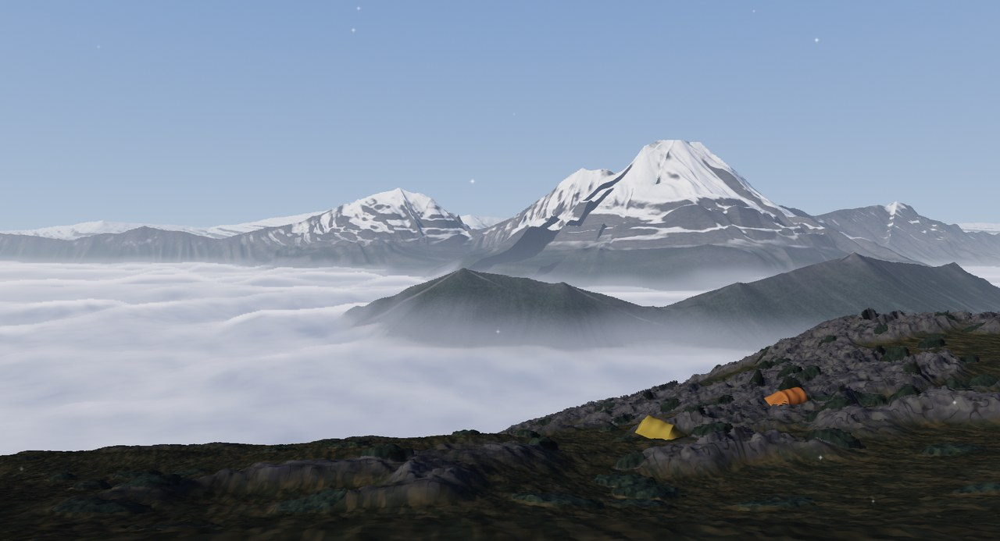
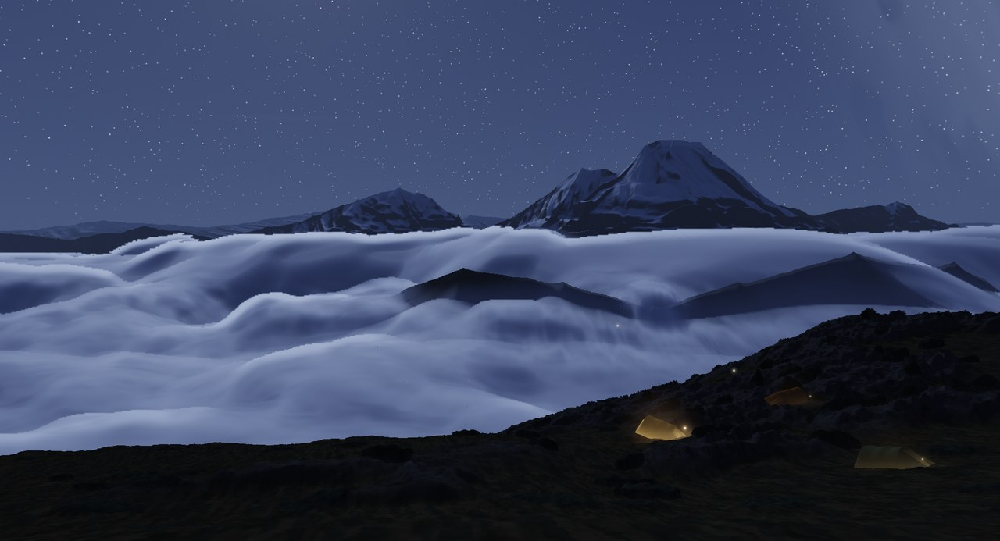

[繁體中文](README.md) · **English**

# VibingWrapper

A Windows live wallpaper that follows your Claude Code sessions — sky, sea, snow peaks, rice paddies, and a level crossing.

When Claude is thinking, the sky clouds over. When it starts running tools, a thunderstorm rolls in. When it's done, the rain stops and the sun breaks through.
And when it stops to ask you a question or wait for your approval, a single star lights up and slowly pulses.
You never have to switch windows: the corner of your eye tells you what your AI is up to.


*Overcast → storm → clearing → star: Claude thinking, running tools, done, waiting for you.*

## States

| What Claude Code is doing | Weather | Top-right HUD |
|---|---|---|
| Idle | Clear | AI · 待命 (standby) |
| Got your prompt (UserPromptSubmit) | Overcast | AI · 思考中 (thinking) |
| Running tools (PreToolUse) | Thunderstorm | AI · 執行中 (working) |
| Finished (Stop) | Clearing, then clear after 20 s | AI · 收尾 (wrapping up) |
| Asking you a question / waiting for permission | Sky dims, one star pulses | AI · 等你 (waiting for you) |

**Several sessions at once (up to 5):** each session keeps its own state, and the sky shows the most urgent one (waiting > storm > overcast > clearing > clear).
On the sea wallpapers every session is a boat: busy boats get underway with a wake behind them, and the boat that is waiting for you blinks its lamps — so you can tell at a glance which session needs you.


## Wallpapers

Gear menu → 桌布 (wallpaper) cycles through them. Each one acts out the same states in its own way:

| Wallpaper | Scene | When Claude gets busy |
|---|---|---|
| **Weather (天氣)** | Sky only: clouds, rain, lightning, crepuscular rays, following the real sunrise and sunset in Taipei | Clouds over, then a thunderstorm |
| **Weather + sea (天氣＋海)** | A distant sea mirroring the same sky; one boat per session | Storm; boats get underway with a wake |
| **Sea (海)** | A 3D ocean seen from just above the water: crests, foam, moonlight, the fleet riding the swell | Storm and whitecaps |
| **Snow peaks (雪山雲海)** | A sea of clouds seen from a Taiwanese high ridge; one mountaineering tent per session | The sky stays clear (real cloud seas happen in fair weather); the cloud sea rises, pours over the saddle, and spindrift blows off the ridge |
| **Paddy (稻田)** | Rice paddies in rural Pingtung, blue hills, a cabin, blazing sun | Stronger wind, bigger waves in the rice, more chimney smoke |
| **Meadow (寫實草原)** | Hundreds of thousands of grass blades bending in the wind; one cabin per session | Gusts sweep across the grass like waves, kicking up dry leaves |
| **Level crossing (平交道)** | A Taiwan Railway level crossing in the countryside (Godot 4) | Bells ring and the barriers drop while it thinks; the train keeps passing for as long as it works |

<table>
<tr>
<td width="50%"><br>Snow peaks · morning</td>
<td width="50%"><br>Snow peaks · working at night, the cloud sea churns</td>
</tr>
<tr>
<td><br>Level crossing · working, the train rolls by car after car</td>
<td><br>Level crossing · alarm at night</td>
</tr>
<tr>
<td><br>Paddy · full sun</td>
<td></td>
</tr>
<tr>
<td><br>Weather · working (thunderstorm)</td>
<td><br>Weather + sea · the fleet at dusk</td>
</tr>
<tr>
<td><br>Sea · daytime</td>
<td><br>Sea · thunderstorm</td>
</tr>
</table>

The gear menu's 模式 (mode) switches between following the real clock, always day, and always night.

The wallpaper lives behind your desktop icons and never gets in the way. It pauses itself while a maximized or full-screen window covers the desktop.

**The level crossing needs a build step**: it is a Godot 4 web export (about 60 MB), so git only holds the source (`godot/crossing/`). See [themes/crossing/README.md](themes/crossing/README.md) (Chinese; two `godot --headless` commands). Without the build it shows up blank.

### Make your own theme

Each wallpaper is a folder under `themes/` (`theme.json` + page + notes). Copy a folder and change the name in `theme.json` —
it shows up in the gear menu's wallpaper list, no changes to the app needed. The folder contract is in [themes/README.md](themes/README.md) (Chinese).

## Little tools

| Feature | Shortcut | What it does |
|---|---|---|
| Hide desktop icons (收桌面) | Ctrl+Alt+D | Hides / shows every icon on the desktop: folders, shortcuts and files alike (one feature). Press again to bring them back |
| Boss key (還原桌面) | Ctrl+Alt+B (**changeable in the gear menu**) | Wallpaper and tray icon vanish, the HUD shrinks to a faint gear, and icons hidden by Ctrl+Alt+D come back, so it looks like an ordinary work desktop. **Press the same shortcut again to restore** — no need to click the gear (gear → 取消隱藏 also works) |
| Region screenshot (範圍截圖) | Ctrl+Alt+S | Drag a box: PNG to the clipboard plus a copy in `Pictures\Saved Pictures` (`截圖_date_time.png`). Esc or right-click cancels |

These are **global shortcuts**: while VibingWrapper runs it takes them from every app, so they all start with Ctrl+Alt and leave everyday keys like Ctrl+R (reload) and Ctrl+Q alone.
If another program already holds one, the tray menu marks it 被占用 (taken) and the feature is still a click away in the tray or gear menu.
The boss key and the region screenshot key can be changed: gear → 設定 (settings) → 快捷鍵, click one, then press the new combination.

**Updates**: a red dot on the gear means a newer build is out. Gear → 設定 → 更新方式 picks 自動 (automatic, the default: downloads, swaps the files and restarts while Claude is idle) or 手動 (manual: only the dot; click 更新 to install). Settings, logs and downloaded themes live in `%APPDATA%\vibing-wrapper` and survive updates. Running from source, update with `git pull`.

The UI is in Traditional Chinese.

## Install

### Let an AI install it (recommended)

Paste this to Claude Code or Codex. It reviews the code for security concerns first and installs only once you agree:

```text
Install VibingWrapper (https://github.com/youllook/VibingWrapper) for me: a Windows live wallpaper that follows Claude Code / Codex.
1. Clone it into a folder I choose (ask me if I haven't said). Before installing, do a security review and sum it up in a few sentences:
   - which local port it opens, what data it receives, whether it talks to any outside server
   - which files it writes (especially the hooks it adds to ~/.claude/settings.json and ~/.codex/hooks.json)
   - anything suspicious in package.json dependencies or install scripts
2. Once I agree, run npm install and npm start, and npm run shortcut for a desktop shortcut.
3. Ask me to click the gear (top right) → "Claude 連動" (and "Codex 連動" if I use Codex) to add the hooks, then tell me which sessions to restart.
Note: this only works with Claude Code (CLI, or the Code tab in Claude Desktop) and Codex; plain Claude Desktop chats have no hooks, so the sky won't react.
```

### Quick try (no install)

1. Download `VibingWrapper-x.y.z-win-x64.zip` from [Releases](https://github.com/youllook/VibingWrapper/releases/latest) and unzip it anywhere (it unpacks into a `VibingWrapper-x.y.z` folder).
2. Run `VibingWrapper.exe`. The build is unsigned: if Windows SmartScreen says "Windows protected your PC", click "More info" → "Run anyway".
3. Click the gear (top right) → "Claude 連動" to add the hooks to `~/.claude/settings.json` (your file is backed up once as `settings.json.vibing-backup`; existing settings are kept).
4. Restart Claude Code and start working: the sky follows along.

No Node.js needed; all seven wallpapers (including the Godot level crossing) are bundled. To just try the wallpapers without Claude Code, take the `-lite` zip: it ships only 基礎版 (basic: misty grey hills with the live state of every session in the middle and a debug panel), and the other wallpapers install from the gear menu → 桌布 → 主題庫 (theme library).

**Uninstall**: gear → "解除安裝", or Windows Settings → Installed apps → VibingWrapper → Uninstall (it is listed there after the first run). It removes our hooks from Claude Code (other settings stay), turns off start-with-Windows, and after the app closes deletes `%APPDATA%ibing-wrapper` and the program files.

### Run from source

Requires Windows 10 / 11, [Node.js](https://nodejs.org/) 18+, and [Claude Code](https://claude.com/claude-code).

```bash
git clone https://github.com/youllook/VibingWrapper.git
cd VibingWrapper
npm install
npm start
```

`npm run shortcut` creates a desktop shortcut. "Start with Windows" (開機自動啟動) is in the tray menu.

**Build it yourself**: `npm run dist` packages `dist/VibingWrapper-x.y.z-win-x64.zip` with electron-builder (the same file as on Releases, everything inside a `VibingWrapper-x.y.z/` folder; `npm run dist:lite` builds the lite zip). The level crossing's Godot export is not in git; export it first as described in [themes/crossing/README.md](themes/crossing/README.md), or the build ships without it.

## Connect Claude Code

The gear menu's "Claude 連動" item installs these for you (see Quick try). To do it by hand: VibingWrapper listens for Claude Code hook events on `127.0.0.1:47321`. Merge this into the `hooks` of `~/.claude/settings.json` (if you already have hooks, add these entries to the matching arrays rather than replacing them):

```json
{
  "hooks": {
    "SessionStart":     [{ "hooks": [{ "type": "command", "command": "curl -s -m 1 -o /dev/null -X POST -H \"Content-Type: application/json\" --data-binary @- http://127.0.0.1:47321/claude 2>/dev/null || true", "timeout": 3, "async": true }] }],
    "UserPromptSubmit": [{ "hooks": [{ "type": "command", "command": "curl -s -m 1 -o /dev/null -X POST -H \"Content-Type: application/json\" --data-binary @- http://127.0.0.1:47321/claude 2>/dev/null || true", "timeout": 3, "async": true }] }],
    "PreToolUse":       [{ "hooks": [{ "type": "command", "command": "curl -s -m 1 -o /dev/null -X POST -H \"Content-Type: application/json\" --data-binary @- http://127.0.0.1:47321/claude 2>/dev/null || true", "timeout": 3, "async": true }] }],
    "Notification":     [{ "hooks": [{ "type": "command", "command": "curl -s -m 1 -o /dev/null -X POST -H \"Content-Type: application/json\" --data-binary @- http://127.0.0.1:47321/claude 2>/dev/null || true", "timeout": 3, "async": true }] }],
    "Stop":             [{ "hooks": [{ "type": "command", "command": "curl -s -m 1 -o /dev/null -X POST -H \"Content-Type: application/json\" --data-binary @- http://127.0.0.1:47321/claude 2>/dev/null || true", "timeout": 3, "async": true }] }],
    "SubagentStop":     [{ "hooks": [{ "type": "command", "command": "curl -s -m 1 -o /dev/null -X POST -H \"Content-Type: application/json\" --data-binary @- http://127.0.0.1:47321/claude 2>/dev/null || true", "timeout": 3, "async": true }] }],
    "SessionEnd":       [{ "hooks": [{ "type": "command", "command": "curl -s -m 1 -o /dev/null -X POST -H \"Content-Type: application/json\" --data-binary @- http://127.0.0.1:47321/claude 2>/dev/null || true", "timeout": 3, "async": true }] }]
  }
}
```

When VibingWrapper isn't running, curl gives up quietly after one second, so Claude Code is never slowed down.
Claude Code sessions that were already open need a restart to pick up the new hooks.

Received events are logged by name and the first 8 characters of the session ID only (`%APPDATA%\vibing-wrapper\weather-log.jsonl`, rotated at 1 MB) — never prompt text, commands, or paths.

## Files

| Path | What it is |
|---|---|
| `main.js` | Electron main process: HUD window, tray, settings |
| `prototype/hud.html` | The top-right AI state icon + gear menu |
| `tools/claude-bridge.js` | Hook events → per-session state → combined weather → `%APPDATA%\vibing-wrapper\state.json`; also serves the `themes/` pages and the theme list |
| `tools/claude-hooks.js` | Gear menu "Claude 連動": adds the hooks to `~/.claude/settings.json` |
| `tools/wallpaper.js`, `attach-wallpaper.ps1` | Parents the wallpaper window behind the desktop icons (WorkerW) |
| `themes/<id>/` | One folder per wallpaper: `theme.json`, `index.html` (a single WebGL shader), `README.md`; currently `weather`, `sea`, `ocean`, `snowpeak`, `paddy`, `crossing` |
| `godot/crossing/` | Godot 4 source for the level crossing (the scene is built in code; `shell.html` is the web shell) |
| `themes/demo.html` | Tuning page: pick a theme, switch states, scrub the clock through day and night |
| `tools/desktop-icons.*`, `boss-key.js`, `capture.*` | Desktop-icon toggle, boss key, region screenshot |

## Credits

- Cloud rendering after [power418/skygl](https://github.com/power418/skygl) (MIT), squeezed into a single 2D pass.
- The grass in the paddy is ported from SimonDev's [Quick_Grass](https://github.com/simondevyoutube/Quick_Grass) (MIT), itself based on Ghost of Tsushima's GDC 2021 talk.
- The level crossing is built with [Godot 4](https://godotengine.org/).
- The 3D ocean, the fleet and the first pass of the snow peaks were designed and built by Claude (Fable); the AI state icons, the logo and the level-crossing textures were painted by Codex.
- The whole project was written with Claude Code.

## License

[MIT](LICENSE)
