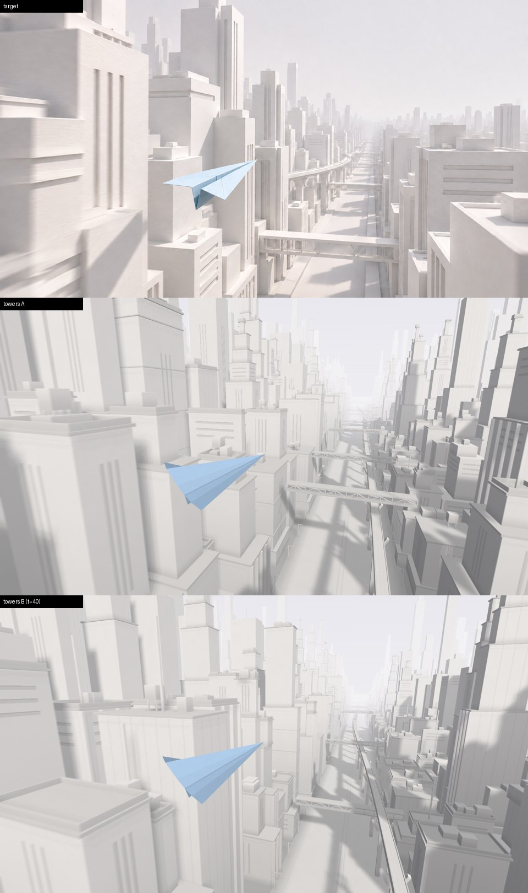
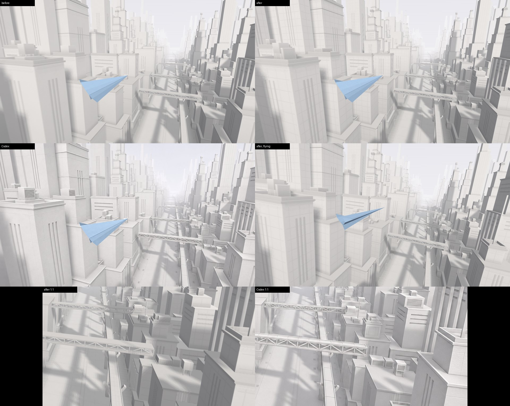
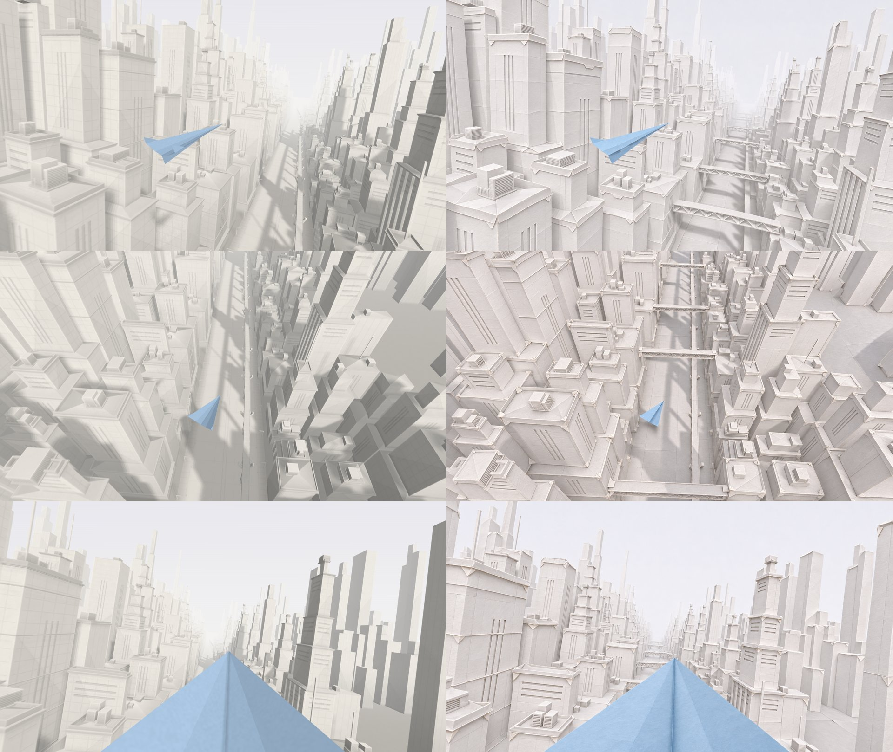

# 紙飛機穿城 · 8 對原圖抓細節（2026-11-28）

對照：`08-細節比對.jpg`（上＝n03a、中＝靜止構圖 `?fly=0`、下＝飛行中）。亮度分布用 `tools/lum.py` 比（p5/p25/p50/p75/p95）。

| 差異 | 原圖 | 改法 |
|---|---|---|
| 立面 | 少數幾道「真的凹進去」的槽：三道直槽或三道橫槽，其餘大多素面 | 每棟一組樣式（直槽三道 38%／橫槽三道 24%／素面 28%／細溝 10%），槽內暗＋一側內壁更暗；拿掉滿牆窗帶；纖維噪聲改細，不再出現橫向髒紋 |
| 邊角 | 摺角、切口吃光 | 立面左右邊與頂端各一條細亮線 |
| 光 | 冷白、影子淺而軟 | 日光改從右後方偏鏡頭（0.45, 0.62, 0.65）、影子強度 0.72、PCF 半徑 5；色溫改冷白 |
| 亮度 | p50 213、p75 229 | 調到 p50 212、p75 229（暗部 p25 仍偏亮 201 vs 182） |
| 量體 | 鏡頭在屋頂高度，看得到很多屋頂 | 鏡頭升到 74 m、俯 12°、往街心移；左側第一排降到 24–72 m |
| 單軌 | 粗梁、Y 形墩 | 梁寬 3.4 m＋兩側唇；墩＝柱＋兩支斜臂＋墩帽 |
| 空橋 | 桁架有斜撐 | 直桿每 4 m＋V 形斜撐 |
| 街道 | 中央分隔 | 兩條矮分隔帶 |
| 紙飛機 | 較大、翼面有上反和摺面 | 放大到 3.9；每邊主翼多摺一道、翼尖抬高 |
| 遠景 | 塔樓剪影 | 遠景改從離街 140 m 起，避免近處出現巨大的暗面板 |

## 還差的
- 原圖中景有幾棟階梯式收頂的高塔「冒出來」，我們中景高度太平均。
- 暗部（巷縫、建築之間的深影）還不夠，p25 比原圖亮。

## 09 暗部（2026-11-28）

- 只動整體光（環境光、影子濃度、日光方向）暗部幾乎不變：p25 卡在 192–197，日光轉到側面會把整張壓暗（p50 掉到 170–179），不採用。
- 真正差在**街谷底部**：原圖的街面和大樓下段是灰的，我們是白的。
  - 立面加「街谷暗化」：離地越低越暗，0 m 乘 0.70、70 m 以上不變（`CANYON`，網址 `?canyon=` 可調）；屋頂不受影響。
  - 街面整片乘 0.86、巷子 0.74、牆腳 7 m 內再暗到 0.70。
- 結果 p5/p25/p50/p75/p95：原圖 166/182/213/229/239，之前 157/196/211/229/236（舊鏡頭），現在 146/186/206/226/236。
- 還差：中景階梯式收頂高塔。

## 10 中景階梯高塔（2026-11-28）

- 後排（第 2 排 16%、第 3 排 22%）偶爾一棟拔高到 1.35–1.95 倍（至少 70 m 起算），底座佔 42–54%，往上 3–4 段各收 72–82%，六成再加一根細頂；每段頂都有簷口。
- 用由 `seed` 導出的獨立亂數，其他建築的排列不變。
- 實例數每段約 210–350（上限 1600），亮度分布不變（p25 185）。

## 11–12 Codex 細節版 → 落地（2026-11-28）

- 截圖交給本機 Codex 保構圖加細節（`codex/`：prompt、notes、兩張 webp、11-codex對照.jpg）。
- 落地項目：
  - 立面板縫：每層 3.6 m 橫縫、約 4 m 直縫，fwidth 抗鋸齒、遠處淡掉；凹槽與細溝樣式不畫。
  - 簷口改兩層紙板（下薄上寬），本體頂端 1 m 接觸陰影，亮線移到配件頂。
  - 屋頂機房改 `unit`：等距百葉，可見排加底座薄板。
  - 單軌梁改 `beam`：每 3 m 一道接縫。
  - 地面：人行道每 3 m 分縫、車道每 12 m 分縫、路緣內側每 15 m 一塊排水格柵。
  - 紙飛機加細纖維。
  - 清晰度：內部解析度 0.6 → 0.75、模糊上限 28 → 20 px、待命快門 0.03 → 0.02。
- 效能（2060S，Electron）：1080p 約 4.2 ms。亮度分布不變（p25 184–187）。

## 15–16 紙摺感（2026-11-28）

- Codex 紙摺版在 `codex-paper/`（三個視角、notes）。用戶選：不做三角舌片、移除空橋，其餘都做。
- 屋頂：每一段頂上一個淺四角錐（坡高＝短邊 16%），平面著色出四條對角摺線；屋頂物件依斜面墊高。
- 紙邊：每條邊都有細亮切口線（含屋頂與四角錐外框、配件底緣）。
- 立面：每面一道斜摺痕（一側略亮、一側略暗、線上淺谷），加大尺度淺皺、纖維加強。
- 光：環境光略暖、影子濃度 0.72 → 0.68、街谷暗化 0.70 → 0.76；第一輪太黃太霧，已拉回中性。
- 空橋移除（亂數照吃，其他排列不變）；俯衝改成隨機深度 34–48 m。
