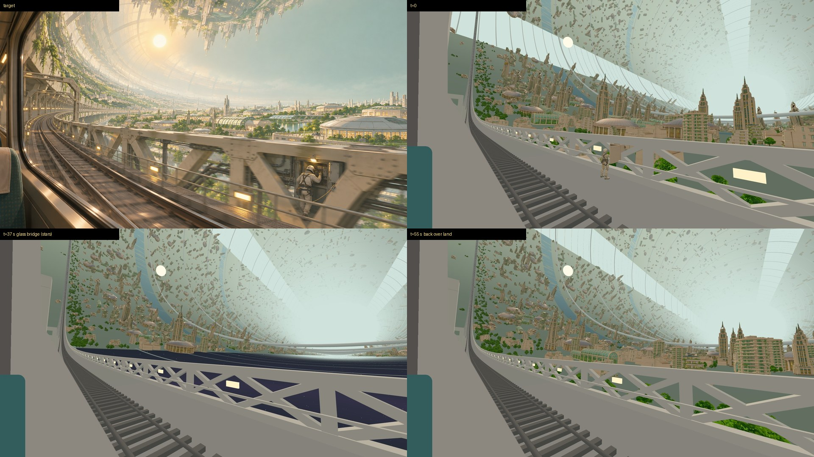

# 環形太空站 · 3 擺景驗收（2026-11-28）

## 分數（灰模分層遮罩 vs Codex 四層標準答案，480×270）
| 層 | IoU |
|---|---|
| 鏡頭層（窗框） | 0.64 |
| 近景（軌道、桁架、維修工） | 0.64 |
| 城市 | 0.44 |
| 遠景天空 | 0.85 |
| **像素一致率** | **80.0%**（窗帶改 20° 後 79.3%） |

座標下降兩輪（鏡頭 yaw 46°、pitch 5°、roll 0.5°、垂直 FOV 79°、高 3.2 m；陸地帶 ±40°）後卡在 80%。
剩下的差距是**結構性的**：目標圖是畫的，軌道往左彎、倒掛城市壓得很低——真實圓筒做不出來（圓筒內沿圓周的軌道永遠是一條過鏡頭的平面，投影是直線）。再逼近就得破壞「轉一圈回原點」的幾何，不划算。

## 跑起來才看得到的問題（待決定）
- ~~玻璃窗帶佔圓周 1/3~~ → **2026-11-28 用戶定：窗帶每段 20°（陸地 ±50°）**。列車每 76 秒過一次玻璃橋、約 13 秒，橋下是星空（窗帶 shader：近看星空隨太空站自轉 0.07 rad/s 掃過，700–2600 m 漸變成霧色，遠處窗帶仍是亮天空）。改完相似度 79.3%（城市層 IoU 0.44 → 0.46）。
- 倒掛城市在灰模平光下像漂浮碎屑；步驟 4–5 上霧與大氣透視後再看。

## 已知小毛病（步驟 4 一起處理）
- 車窗框還是螢幕空間的平面遮罩，沒有厚度與玻璃反光。
- 近處維修燈是一塊米色方塊（燈具還沒做材質）。
- 維修工朝向待確認（目標圖是背對鏡頭、手伸進配電箱）。
