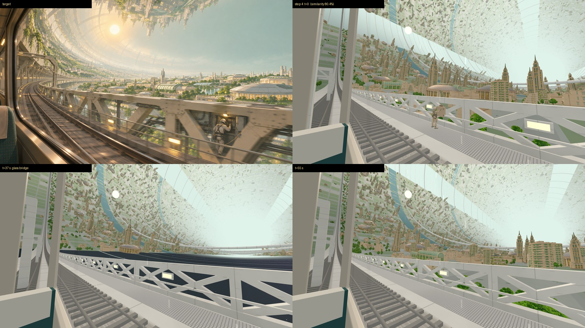

# 環形太空站 · 4 材質貼圖（2026-11-28）

## 做了什麼
| 元素 | 做法 |
|---|---|
| 車窗 | 螢幕空間遮罩換成**真的 3D 車廂右牆**：圓角窗口（ExtrudeGeometry、0.22 m 窗框厚度、倒角）、前方窗柱擋住消失點左邊、前排座椅背＋白頭枕套、近乎透明的玻璃（加法混色的車內反光、斜向擦拭痕、灰塵點）。參數 `wx ys yt px pz sx sy sz` 用座標下降對窗框層調過。 |
| 地面 | 程式街廓（`materials.js` 注入 Lambert，保留光照與霧）：主幹道 240 m、巷道 80 m、人行道；街廓依亂數當公園／廣場／花園，草地有樹冠斑點。 |
| 橋面 | 混凝土板（6 m 接縫）、兩組軌道下的深色道碴、右側格柵人行道（遠處自動糊成平均色避免摩爾紋）。 |
| 護欄桁架 | 象牙白烤漆、2 m 接縫、鉚釘、下半部髒污；維修燈加燈座。 |
| 拱肋 | 白色金屬分段。 |
| 維修工 | 背對鏡頭、面向桁架；配電箱門朝他打開。 |

## 相似度
3D 窗框後鏡頭層 IoU 0.64 → 0.67、近景 0.64 → 0.70；整體像素一致率 **80.4%**。

## 留給步驟 5（燈光、霧、氛圍、狀態）
- 目前是平光：沒有目標圖那種淡金色日光、玉色大氣、太陽光暈。
- 倒掛城市在沒有大氣透視時像漂浮碎屑 → 要靠距離霧＋高度霧把它壓成剪影。
- 近景沒有動態模糊（目標圖桁架是糊的）。
- 窗燈、夜間模式、五種狀態都還沒接。
