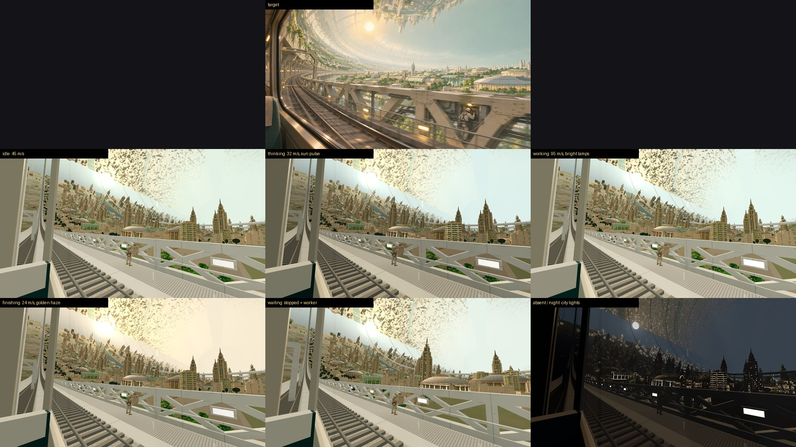

# 環形太空站 · 5 燈光、霧、氛圍、狀態（2026-11-28）

## 光與大氣（`atmos.js`）
- **大氣霧**：覆寫 three.js 的霧 chunk，全場（含 Tripo 模型）共用。借線性霧的 near／far 兩個欄位傳「霧密度」與「太陽散射強度」，不必逐一改材質。
  - 往太陽方向的霧發亮（鏡頭不動 → 太陽的視線方向是常數，直接烘進 shader）。
  - 氛圍優先：往上看霧淡 45%（頭頂倒掛城市看得清楚），沿軸往地平線最濃。
- **軸光**：圓筒裡的光其實來自轉軸，面向軸的面都該亮。遠處（1.2–3.2 km 漸入）的地面與代理建築加這一項，倒掛城市才不會變成暗色碎片。近處保留目標圖的太陽方向。
- **太陽**：亮盤＋加法混色柔光精靈；ACES 色調映射；淡金色日光＋玉色天光／暖地面的半球光。
- **窗燈**：Tripo 貼圖裡明顯偏黃橘的像素（線性色 r−b > 0.42）就是窗，夜裡依每棟 instance 的亂數陸續點亮；遠景代理形狀則在物件空間撒窗點。

## 狀態（每秒讀 `state.json`；`?state=` 固定一種）
| 狀態 | 速度 | 畫面 |
|---|---|---|
| 待命 idle | 45 m/s | 白天基準 |
| 思考 thinking | 32 m/s | 太陽微微脈動、部分窗燈亮 |
| 執行 working | 95 m/s | 桁架燈加亮 2.6 倍，掠過感最強 |
| 收尾 finishing | 24 m/s | 霧轉金、太陽散射加強 |
| 等你 waiting | 停車 | 列車減速停下；**幾乎停住時維修工出現在旁邊的配電箱**（約 10 m） |
| 不在 absent | 30 m/s | 夜間：人造太陽調暗、全城窗燈、霧轉深藍 |

真實時鐘 19–6 點也是夜間（18–19、6–7 點漸變）；`?day=1`／`?night=1` 固定。參數都以 2.5 秒（速度 4 秒）時間常數漸變。

## 效能（RTX 2060 SUPER，1152×648）
| | 三角形 | draw calls | 每格 |
|---|---|---|---|
| 步驟 4 結束 | 2,900 萬 | 358 | 25 ms |
| **三級 LOD 後** | **570 萬** | **73** | **7.5 ms** |

- 三級 LOD：近（< 500 m）Tripo 1 萬面、中（< 1.5 km）減面版、遠＝程式代理形狀（20–60 面、貼圖平均色）；樹只有近（< 150 m）／遠兩級。
- 窗帶縱肋 411 個網格合成 1 個。
- 30 fps 上限、渲染解析度 0.6 倍。**內顯還沒測**（步驟 6）。

## 沒做／留給步驟 6
- 近景動態模糊（目標圖桁架是糊的）。
- 內顯效能實測、裝進桌面實際跑一輪（錄動態分鏡）。
- 擺景相似度維持 80.4%（燈光不影響分層遮罩）。
