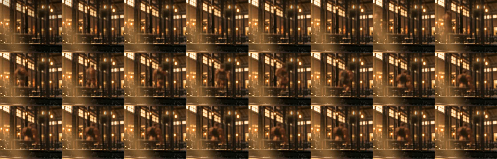
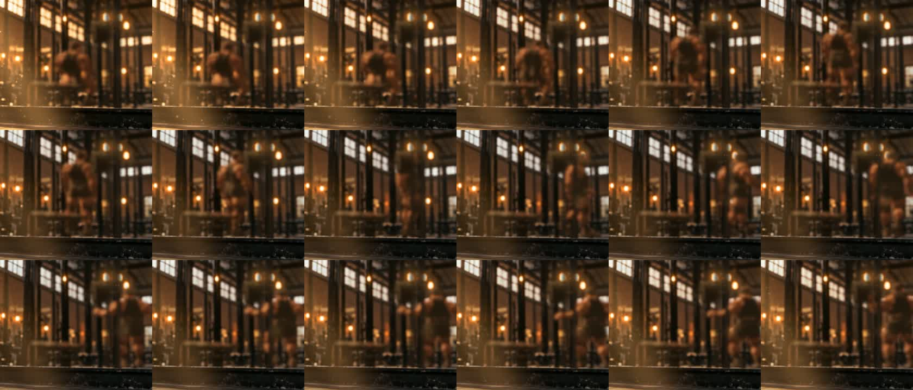

# 健力健身房 2 — 07 動作生成（MotionBricks）

2026-10-31 交付後追加：把第一版留下的走路、坐下換成 NVIDIA [MotionBricks](https://github.com/NVlabs/motionbricks) 生成的動作，新增「走過來轉身坐下」與「站起來」。用戶看桌面：「相當不錯，順利到不行」。

| 坐下（每 0.5 秒一格） | 站起（每 0.33 秒一格） |
|---|---|
|  |  |

## MotionBricks 在做什麼

給它最近 4 格姿勢（起點）和 1–4 格目標姿勢，它補出中間 0.6–1.9 秒的動作（30 fps，SOMA 人體骨架的 30 個關節＋整體位置）。長度由模型自己決定。
內部三塊：路線模組（花多久、走哪條路）→ 姿勢模組（Transformer 沿路線填動作 token，4 格一個 token）→ 解碼器（VQ-VAE 還原成連續動作，頭尾準確接上起點與目標）。訓練資料是 Bones 約 35 萬段真人動捕，所以起步、轉身墊步、坐下前放慢都像真人。

## 這次生成了什麼（`tools/motionbricks/gen2.py`）

座標：坐姿 S_a 的髖部在原點、面朝 +Z。

| 動作 | 起點 → 目標 | 長度 |
|---|---|---|
| `SitDown` | 凳子前 1.3 m、偏 0.35 m 走路中 → 坐姿 S_a | 1.9 s |
| `Sit` | S_a → S_b → S_c → S_a（三段串成循環） | 3.8 s |
| `StandUp` | S_a → 站起往前踏一步 | 1.9 s |
| `Walk` | 走路 4 格 → 同樣 4 格往前挪 2.6 m（頭尾自然接得起來的循環） | 1.8 s，1.34 m/s |

## 轉到選手骨架（`tools/motionbricks/bake.py`，Blender 背景跑）

- SOMA 與選手的 Mixamo 骨架比例不同、靜止姿勢也不同（T 對 A），所以不抄旋轉：每根骨頭用兩個方向（例如上臂＝肩→肘、胸口朝前）組成框架，讓選手的骨頭框架對齊 SOMA 的。髖部高度依腿長比例縮放。
- 頭部的方向以 SOMA 參考姿勢的頭為準（一開始用選手頭骨的方向，結果整段仰頭）。
- `SitDown`、`StandUp`、`Walk` 的地面位移與轉向（平滑過）拆出來：動作在 GLB 裡原地播，位移寫進 `models/mb-root.json`，由 `index.html` 的 `seatClip()` 帶著選手走，錨點是座位 `SIT`。這樣走路接坐下時不會滑步或瞬間轉身。
- 坐著時髖部對到第一版 `Sit` 的位置，凳子不用重擺。

## 授權

MotionBricks 程式碼 Apache-2.0；模型是 NVIDIA Open Model Agreement（可商用）。生成時當起點／目標的範例動作 BVH 是 NVIDIA Sample Data Evaluation License（評估用）——要拿去收錢的主題，目標姿勢改用自己的動作重新生成。

## 跑法

MotionBricks 本體 clone 到 `E:\tmp\motionbricks`、`git lfs pull`、`uv sync`（RTX 2060 SUPER 可跑；第一次會建 TensorRT 引擎）。在本體目錄 `uv run python gen2.py` → Blender `-b -P bake.py -- <clips> <原 GLB> <新 GLB> <mb-root.json>`。
