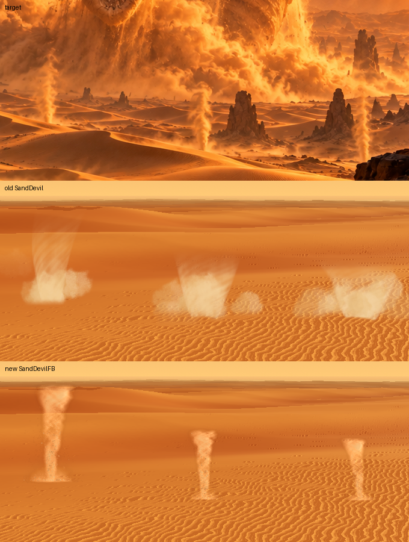
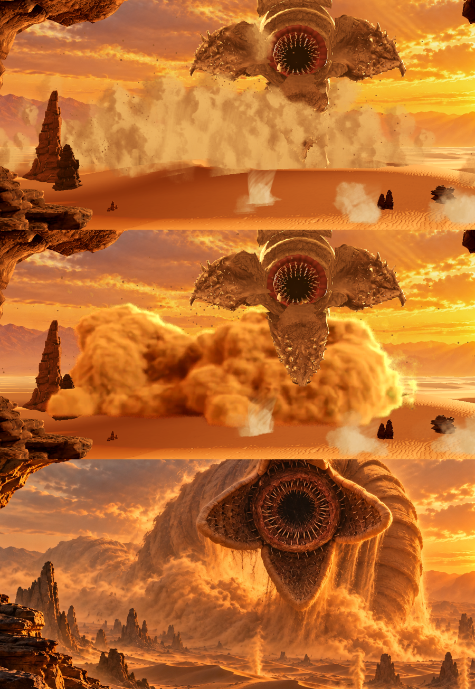

# 沙蟲 — 05 燈光、特效、氛圍（2026-10-30）

## 塵捲風（導流線序列）

做法：照「AI agent + Blender：用程式碼做龍捲風」——螺旋**導流線**帶著沙粒爬升繞圈、有些甩出去落回，外面包一層薄的體積塵；在 Blender 烘成 4 秒無縫循環，Godot 裡用一張只繞 Y 轉向鏡頭的板子播（flipbook）。舊的 `SandDevil`（shader 圓筒＋塵團）保留不動，這是替代品 `SandDevilFB`。



- [devil-compare.png](05-燈光特效氛圍/devil-compare.png)：上＝目標圖、中＝舊 `SandDevil`、下＝新 `SandDevilFB`（同位置、同高度，主線同一支鏡頭）
- [devil-preview.png](05-燈光特效氛圍/devil-preview.png)：preview 全畫面；[devil-close.png](05-燈光特效氛圍/devil-close.png)：`close=1` 拉近；[devil-gray.png](05-燈光特效氛圍/devil-gray.png)：`gray=1`
- [devil-bake.png](05-燈光特效氛圍/devil-bake.png)：烘出來的格子（兩款各 6 格，深色底）
- [devil-clip.mp4](05-燈光特效氛圍/devil-clip.mp4)（新）／[devil-clip-old.mp4](05-燈光特效氛圍/devil-clip-old.mp4)（舊）：6 秒、裁到塵捲風一帶放大 2 倍；[devil-clip-frames.png](05-燈光特效氛圍/devil-clip-frames.png) 每 20 格抽一張

### 烘焙（Blender）

`godot/sandworm2/sand/blender/devil_render.py`（`blender -b --factory-startup -P … -- --variant 0|1`）→ `devil_atlas.py` 拼圖集。

| 項目 | 做法 |
|---|---|
| 導流線 | 螺旋線，半徑 0.7 m（腳）→ 2.4 m（頂），頂端再張開 1.1 m（柔軟的頭）；中心線隨時間擺動（款 0：1.1 m；款 1：1.5 m 再往左斜 0.5 m） |
| 沙粒／小沙團 | 1500 顆沿導流線繞圈爬升（0.5–0.85 圈/秒），其中 32% 半途被甩出（切線速度＋往外踢），之後只受重力（9.8）落回、落地消失；腳下另 500 顆被踢起、拋物線落回的跳沙。半徑 3–6.5 cm，6% 是 9–17 cm 的小沙團（120 m 外約 1–3 px 的斑點） |
| 薄塵套 | Cycles 體積：圍著擺動中心線的空心管（管壁濃、中心淡）× 螺旋條紋雜訊；條紋在「跟著轉」的座標系取樣（角度 = ωt − κz，κ 0.8 rad/m），看起來條紋一直往上爬（約 3.9 m/s）；腳下一圈低塵 |
| 無縫循環 | 每顆粒子的狀態只是 s = frac(k·t/T + φ)（k 整數）的函數，條紋座標系 4 秒剛好轉 2 圈 → 第 72 格接回第 0 格（實測 71→0 的差和一般相鄰兩格一樣） |
| 光 | 灰階：白塵、白太陽，太陽在右前方低處（朝 (0.555, 0.83, 0.08)），微弱的中性環境光；體積前向散射 0.55 → 朝陽那側有亮邊。顏色全部在 Godot 上 |
| 鏡頭 | 正交、120 m 外、往下 6°（我們的鏡頭 25 m 高）；格子 15 × 30 m，柱高 25 m，柱腳在格子底往上 8.2%（2.47 m） |
| 圖集 | 每款 72 格（18 fps × 4 秒），2× 解析度算圖再縮小，12×6 格、每格 160×320 → **1920×1920**，兩款各一張（`sand/textures/devil_fb_0.png`／`_1.png`，各約 3.4 MB）；RGB＝預乘過的亮度、A＝透明度；匯入：無 mipmap、無損 |
| 時間 | RTX 2060S、CUDA（OptiX 這台編譯失敗，自動跳過）：每格約 4–5 秒，兩款共約 12 分鐘 |

### Godot：`sand/devil_fb.tscn`（`SandDevilFB`）

原點＝柱腳（放沙面上）。一張 quad，shader 裡做「只繞 Y 轉向鏡頭」；相鄰兩格交叉淡化；腳下 0.8 m（隨高度縮放）柔邊淡入；板子四邊也淡出；unshaded、不吃霧、不投影。

| export | 預設 | 說明 |
|---|---|---|
| `intensity` | 1.0 | 0–1 透明度；0 = 隱藏 |
| `height` | 25 | 柱高（m），整張板子等比例縮放（改了會重建） |
| `width` | 1.3 | 橫向放寬（烘的柱子比目標圖瘦一點） |
| `sway` | 0.6 | 頂端額外擺幅（m），疊在烘進去的擺動上 |
| `speed` | 1.0 | 播放速度 |
| `seed` | 0 | 雜湊後選款（2 款）＋循環相位；主線用柱腳的 x 就好 |
| `sun_direction` | (0.555, 0.08, −0.83) | 光已烘死（右前方逆光），這裡只決定亮邊多亮（鏡頭越正對太陽越亮） |
| `tint`／`shade`／`glow` | 淡褐／深一階／亮橘 | 本體、背光面與沙粒、逆光亮邊；顏色只從這三個來 |

`look_flat(c)`：三個顏色都換成 c（灰模／分層模式保留柔和的形狀）。

預覽：`SCENE=res://sand/devil_fb_preview.tscn FRAMES=30 ./tools/shot.sh <out.png>`（主線同一支鏡頭、照主線 `DEVILS` 擺三根）；參數 `old=1` 換回舊 `SandDevil` 對照、`close=1` 拉近、`gray=1`／`layers=1`。

### 主線怎麼換

`main.gd` 的 `DEVILS` 迴圈只要換掉 preload，其餘一樣（`height`、`seed`、`position` 同名）：

```gdscript
const DEVIL := preload("res://sand/devil_fb.tscn")   # 原本 devil.tscn
# 迴圈內照舊：n.height = …; n.seed = base.x; n.position = Vector3(base.x, dunes.height_at(base.x, base.z), base.z)
n.sun_direction = SUN_TO
# 要跟塵牆同色：n.tint / n.shade / n.glow = L.dust_tint / dust_shade / dust_glow（或保留預設，比塵牆淡一點，像目標圖）
```

`dump` 那段用 `d.get("top_radius")` 認塵捲風，新節點沒有這個屬性 → 改成 `d is SandDevilFB` 或 `d.get("speed") != null`。

### 已知問題

- **是一張板子**：從正側面看最像；鏡頭繞到很斜（>60°）時光向不對（亮邊烘在右邊）。桌布鏡頭不動，所以沒事。
- 條紋太規律：螺旋條紋近看有一點「交叉格紋」的味道，120 m 外看不太出來；要更亂就把 `devil_render.py` 的雜訊 `Detail`／κ 調亂一點重烘。
- 甩出去的沙粒飛出格子（±7.5 m）就被切掉；靠板子邊緣淡出藏，近看偶爾看得到沙粒在邊上消失。
- `width` 1.3 會把沙粒也橫向拉寬一點（120 m 外看不出）。
- 和沙面的接觸是 `ground_soft` 柔邊，不是深度柔化；放在陡坡上腳下可能有一條淡切線。
- 不吃霧（同其他塵）：遠的塵捲風和近的一樣清楚；要更遠就降 `intensity`。
- 圖集兩張共約 28 MB VRAM（1920² RGBA 無壓縮 ×2）；要省可以把 `devil_atlas.py` 改成單通道亮度＋alpha（RG8）。

## 沙塵滾滾（Blender 體積煙序列）

用戶回饋舊塵牆「看起來比較像煙」。改成：在 Blender 用 Cycles 體積把沙蟲腳下的塵牆做成**一團一團被甩上去、煞住、下垂落回的重沙**，從主線那支**固定鏡頭**渲成 5 秒無縫循環，Godot 裡貼在一張「螢幕對齊」的網格上播。粒子塵團（Skirt／Wall／Core／Veils）關掉，只留噴出又落回的沙粒（Grains）給顆粒感。



- [plume-vs-target.png](05-燈光特效氛圍/plume-vs-target.png)：上＝舊粒子塵、中＝新體積塵、下＝目標圖（同一區域裁切）
- [plume-before.png](05-燈光特效氛圍/plume-before.png)／[plume-after.png](05-燈光特效氛圍/plume-after.png)：全畫面（`FRAMES=60 ./tools/shot.sh`）
- [plume-motion.png](05-燈光特效氛圍/plume-motion.png)：8 秒片段第 0／60／120／200 格（第 0 格是沙蟲還沒就定位的開場格，正常）
- [plume-frame.png](05-燈光特效氛圍/plume-frame.png)：Blender 渲出的單格（透明底）
- 片段：`E:\tmp\sw2\plume_after.mp4`（`./tools/clip.sh … 8`）

### 做法（Blender：`godot/sandworm2/sand/blender/plume.py`）

| 項目 | 做法 |
|---|---|
| 鏡頭 | 與主線完全相同：高 25 m、仰 4.22°、垂直 FOV 50°、1672×941；Godot (x, y, z) → Blender (x, −z, y)。只渲螢幕框 `CROP` = (300, 250)–(1420, 710)，60%（每格 672×276） |
| 塵團（billows） | 約 255 顆球，分五群：貼身體的核心（拋最高 25–55 m）、沙蟲腳下往鏡頭與左邊滾出的主塵、左邊的高塵丘（目標圖 x 330–700）、兩圈貼地往外滾的低裙。每顆的年齡 a = frac(t·k + φ)（k = 1 或 2）：水平位移先快後煞（1 − e^−3a）、高度 sin(π·a^0.72)（上衝快、頂點後緩緩下垂落回）、越滾越大、出生與落地時縮小 → **重的沙，不是往上飄的煙** |
| 塵丘形狀 | 每顆的落點限制在目標圖塵牆的範圍（x −100…75 m、離鏡頭 ≥ 195 m）；x −90…60 之間全高，往兩端降到 0.4 倍 → 圓頂，不是一條平的雲帶 |
| 落沙 | 10 條小球柱從兩片下顎底下以等速落到沙面（目前不太看得出來，見已知問題） |
| 體積 | Geometry Nodes：Points to Volume（1 m 體素）→ Dilate 7 → Grid Mean（寬 3 × 3 次）→ 柔邊的密度場；材質用兩層 4D 雜訊（7 m、2.6 m）侵蝕邊緣做出花椰菜狀的團塊，再加一圈薄的外暈（逆光時發亮）；腳下 0–9 m 淡入（沒有硬切線） |
| 無縫循環 | 球的年齡全是週期函數；雜訊的第 4 維沿一個圓走（z 偏移 = R·cos θ、w = R·sin θ，θ 一輪 2π）→ 第 60 格接回第 0 格（實測 59→0 的差 ≈ 一般相鄰兩格），不用交叉淡化 |
| 光 | 太陽：右前方低角度（朝 SUN_TO）、深橘 (1, 0.55, 0.25)、強度 10；補光：從右前上方打在朝鏡頭的面（氛圍優先於光學）；天空：朝太陽亮、背面暗的橘色漸層 0.7；體積散射色 (1, 0.42, 0.16)、吸收色 (0.75, 0.35, 0.12)、前向散射 0.25；體積反彈 2 次 |
| 遮擋 | 沙面、沙蟲身體圓柱只給光用（鏡頭看不到）：投影與反光有，但不挖洞——遮擋交給 Godot 的深度（見下） |
| 輸出 | Standard 色彩轉換、曝光 0.7（留給 Godot 拉亮，避免亮邊過曝變黃綠）、透明底 RGBA |
| 時間 | RTX 2060S、CUDA（OptiX 這台編不過）、24 spp＋OIDN 降噪：每格約 20 秒，60 格約 20 分鐘 |

### 重渲

```bash
cd godot/sandworm2
"E:/Tools/blender-5.2.2-windows-x64/blender.exe" -b -P sand/blender/plume.py -- --out E:/tmp/sw2/frames
python -I sand/blender/plume_atlas.py E:/tmp/sw2/frames sand/textures/plume_atlas.png 6
./tools/import.sh
```

- 試單格：`-- --still 0 --out …`；看整個構圖（不裁）：`--full --scale 25`
- 可調參數（命令列）：`--sun --sun_c --fill --fill_from --sky --exp --dens --halo --lo --hi --a1 --a2 --n1 --n2 --g --col --abs --foot --voxel --samples --scale --frames`
- 改了 `CROP`、格數或格子大小，要同步改 `sand/plume.gd` 的 `CROP`／`COLS`／`ROWS`／`FRAMES`

### 圖集

`sand/textures/plume_atlas.png`：**4032×2760**（6×10 格、每格 672×276、60 格 = 12 fps × 5 秒），顏色已預乘 alpha，PNG 約 11 MB。
匯入設定：**VRAM 壓縮（S3TC/DXT5）**、無 mipmap → 顯示記憶體約 **11 MB**（無壓縮會是 44 MB）。

### Godot：`sand/plume.tscn`（`SandPlume`，MeshInstance3D）

- `build(cam_transform, fov)`：用主線鏡頭把 `CROP` 反投影成 40×20 格的網格。每個頂點都在它那條像素射線上，所以不論放多深，螢幕上都剛好落在渲染時的位置（不依賴視窗大小）。
- 深度：上半部在鏡頭前 `depth` = 256 m——沙蟲頭、下顎（約 248 m）在塵**前面**，身體（約 270 m）被塵吞掉，跟目標圖一樣；往下的列一旦碰到 `ground_h` = 16 m 高的「假沙面」就改貼在它前面，火山口隆起的稜（14 m）不會把塵腳切掉。
- 排序：`sorting_offset` −120（當成比較遠）→ 沙粒、塵捲風畫在塵上面。不用 `render_priority`：那會讓它排到遠景天空板後面被蓋掉。
- shader `sand/plume.gdshader`：相鄰兩格交叉淡化；預乘 → 還原 → gamma → 飽和度 → × tint × exposure → 再預乘；unshaded、不吃霧、不投影、不寫深度。

| export | 預設 | 說明 |
|---|---|---|
| `intensity` | 1.0 | 0–1 透明度；0 = 隱藏 |
| `speed` | 1.0 | 播放速度（1 = 12 fps，一輪 5 秒） |
| `exposure` | 1.25 | 線性亮度倍率（渲的時候刻意壓暗，在這裡拉回） |
| `gamma` | 1.25 | 圖集 → 線性的指數；2.2 是正規 sRGB 解碼，但經過 Filmic 會變成火紅，1.25 最接近目標圖 |
| `saturation` | 0.85 | |
| `tint` | 白 | 色調 |
| `depth` / `ground_h` | 256 / 16 | 見上（改了要再呼叫 `build`） |

`look_flat(c)`：灰模／分層模式換成單色、保留柔和形狀（`layers=1` 時是中景黃色）。

主線（`main.gd` 的 `_aim_worm`）：建 `Plume` 放在 `mid` 層；兩團 `SandDust` 設 `billows = false`（新 export：關掉 Skirt／Wall／Core／Veils，只留 Grains），主塵的 `fall_count = 0`（舊的沙瀑條帶在新塵前面像白色雨絲）。
命令列：`plume=0` 換回舊粒子塵對照；`plume_exposure=`、`plume_gamma=`、`plume_saturation=`、`plume_depth=`、`plume_ground_h=`、`plume_intensity=` 直接覆寫。

### 效能

一張 800 三角形的網格、每像素 2 次取樣，蓋住畫面約 33%（1120×460 px）、只有一層；舊的塵牆是 340 張大塵團 quad 疊好幾層。填充率與頂點都比舊的省很多，整合顯卡 12 ms 預算內沒問題（沒有在內顯實測）。記憶體多 11 MB VRAM。

### 和目標圖還差的／已知問題

- **落沙瀑布看不出來**：目標圖兩片下顎底下有一道道往下倒的沙幕，這裡的小球柱太細、被後面的塵吃掉。下一步：在 Blender 做成垂直拉長的雜訊幕（往下流的兩相流動貼圖，同樣能無縫），或在 Godot 疊一層新的沙瀑條帶（顏色要跟新塵一致，舊的太白）。
- 塵還是偏「一團團棉花」，目標圖的邊緣更碎、有往下拖的條紋；左邊高塵丘（目標圖那裡其實是沙蟲的背）不夠高、沒延伸到 x 330。
- 只對這支鏡頭成立：鏡頭（位置、仰角、FOV）或沙蟲位置一改就要重渲。
- 沙蟲的頭、下顎靠 Godot 深度擋在塵前面；身體比 256 m 近的部分（很少）也會擋在塵前面。
- 塵團落點有 `ymin`（離鏡頭 ≥ 195 m），所以塵不會滾到近處的岩柱前面；岩柱在塵前面還是後面由網格深度決定（< 256 m 的在前面）。
- 5 秒一輪、每顆塵團一輪只翻一次：盯著看會發現週期；要更自然可以渲 8 秒（96 格，圖集要改成 0.5 倍或兩張）。
- 開場第 0 格沙蟲還沒就定位、塵還沒建（`_aim_worm` 等兩格），主線原本就這樣。
