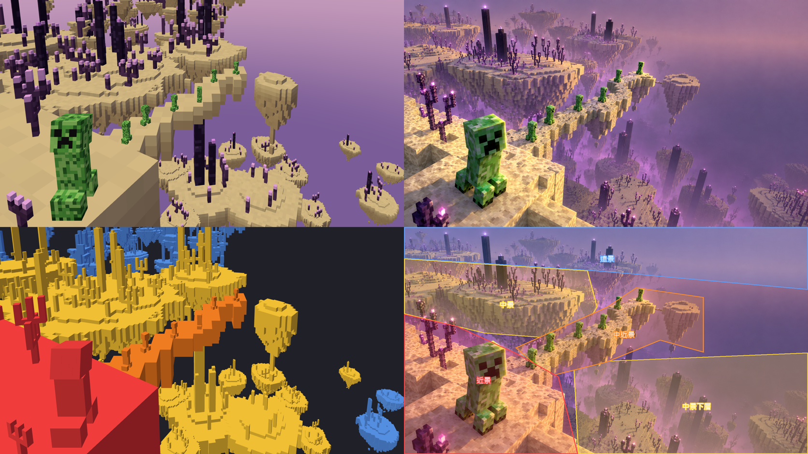
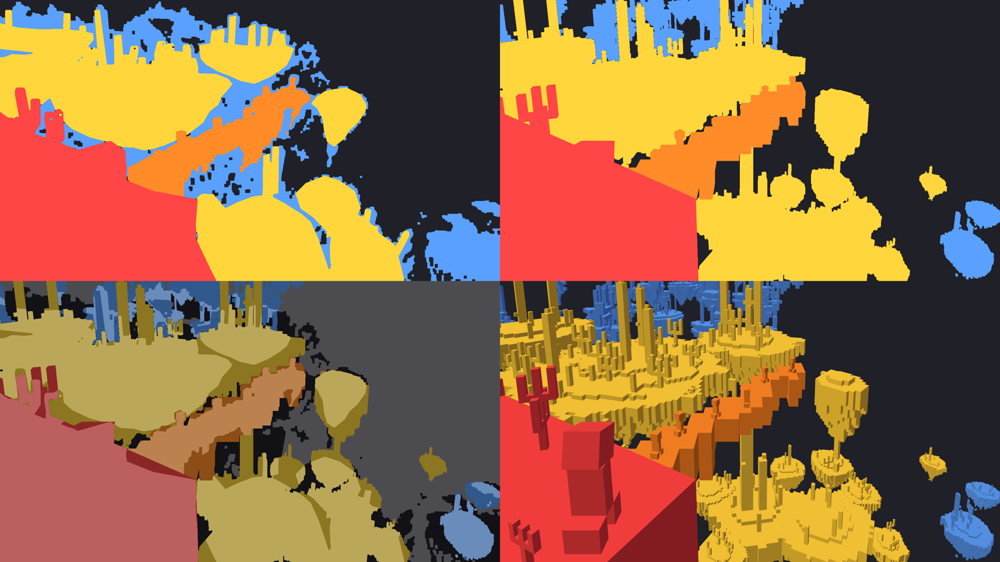

# 麥塊世界 mc3 — 03 場景擺放與結構核對（灰模）

場景：`themes/creeper-end/scene.js`（版面全在 `LAYOUT`、`CAM` 兩張表）　圖：[03-擺放/](03-擺放/)

左上灰模、右上目標圖、左下分層上色、右下 01 分層標註。

## 擺位作法：照目標圖像素反投影

目標圖是強迫透視：主角特大、橋上 6 隻幾乎不縮。用單一比例解鏡頭（2026-10-29 試算），要嘛主角對不上、要嘛變低機位長焦，和「高空俯瞰」的感覺矛盾。所以改成：

1. **鏡頭**：小俯角（10°）＋鏡頭往下位移（`CAM.shift`，移軸）。垂直線保持平行，柱子不會往下歪——目標圖就是這種看法。
2. **落點**：每件東西給「目標圖的像素座標＋一個高度平面」，`onPlane()` 把視線打到那個平面上取世界座標。
3. **大小**：每件各自依目標像素大小縮放（`pxPerUnit()`）：主角照頭到腳 368 px、橋上每隻照各自像素高、島照半寬像素、近景平台照「一格約 110 px」。
4. 遠景島群直接給世界座標（整片放在大島後方、偏左，右上留給 HUD）。

改構圖只要動 `LAYOUT` 的像素數字，不用算 3D 座標。

## 對位工具

| 網址參數 | 用途 |
|---|---|
| `?ref=ref-mc3.png&a=0.5` | 疊目標圖（a＝透明度） |
| `?layers=1` | 依景上色：近紅、中近橘、中黃、遠藍（對 [01-分層標註.png](01-分層標註.png)） |
| `?top=1` | 俯視結構圖：正交俯視＋參考鏡頭視錐（看前後關係有沒有穿插） |
| `?cam=高,俯角,視角,位移` | 臨時試鏡頭 |

離屏截圖：`npx electron "docs/麥塊世界mc3/tools/shot.js" "creeper-end/index.html?layers=1" out.png 1672 941`

## 核對結果

| 項目 | 狀態 |
|---|---|
| 主角位置、大小、正面望鏡頭 | ✅ |
| 平台右緣斷崖位置 | ✅ |
| 橋走向＋6 隻位置大小 | ✅ 幾乎重合 |
| 橋尾缺口＋小圓島 | ✅ |
| 右上 25% 留空 | ✅ |
| 遠景島帶在上緣偏左 | ✅ |
| 大島 | ✅ 倒錐改淺（depth 16），和平台後緣之間露出虛空縫；柱寬改 2 |
| 中景下層島 | ✅ 改成 14 座、更深更小（y −130～−190）；亮度留給霧（階段 4、5）壓 |
| 近景平台頂面 | ✅ 加 `cliffEdits`（makeForeCliff 新參數）：主角右側崖邊缺口、左後抬高一階、左前凹洞 |
| 近景紫頌 | ✅ 同像素高度改用更多格（11 格），莖變細、分枝變多 |

（2026-10-29 用戶驗收前修掉第一輪四個 ⚠️）

## 分層 IoU（對 Codex 扣圖，去背＋去雜訊後）

左上答案、右上灰模、左下差異（亮＝對、暗＝錯）。

| 層 | 第一版 | 第一輪 | 第二輪（掃參數） | 說明 |
|---|---|---|---|---|
| 前景 | 0.85 | 0.85 | **0.91** | 平台改斜擺（見下）；舊的頂面修形是配舊角度的，拿掉 |
| 中近景 | 0.44 | 0.61 | 0.67 | 橋頭往平台延伸、尾端拉長、垂墜關掉＋橋身加厚 1 格；剩下的差在 Codex 遮罩本身較粗（含霧邊），削平台去讓橋頭反而傷前景，不採用 |
| 中景 | 0.42 | 0.57 | 0.70 | 下層島補兩座、右側那座縮小；大島位置大小對 IoU 不敏感 |
| 遠景 | 0.08 | 0.19 | 0.18 | 等階段 4、5 加霧＋補遠島 |

**平台是斜的**（2026-10-29 用戶指出）：目標圖平台的格線、後緣都約轉 45°，轉角朝橋頭。原本把平台正對鏡頭、綁在主角腳下那格，怎麼調頂面都卡在 0.85。改成 `LAYOUT.cliffCorner`：給「後右轉角」像素 (655,665) 和「後緣往哪延伸」像素 (0,375)，兩點反投影到平台高度，算出旋轉角與位置，前景直接 0.91。

第二輪作法：`?tune={…}` 網址參數臨時覆寫 `LAYOUT` 頂層欄位，`tools/sweep.sh '<json>'` 一次拍圖＋算 IoU，逐項掃最佳值再寫回 scene.js。橋的形狀用「兩遮罩疊色圖」（共有白、只有 Codex 綠、只有灰模洋紅）判斷。

第一輪調整：`LAYOUT.islandsMid`（新）、`islandsLower` 重排（右下兩座 `far:true` 歸遠景層）、`islandBig` 收小。makeBridge 新增 `hang`、`depth` 參數。

## 效能（灰模，未量 GPU）

素材預算見 02；場景三角形數印在 console（`tris`）。階段 4 加霧後再在桌面量毫秒。
