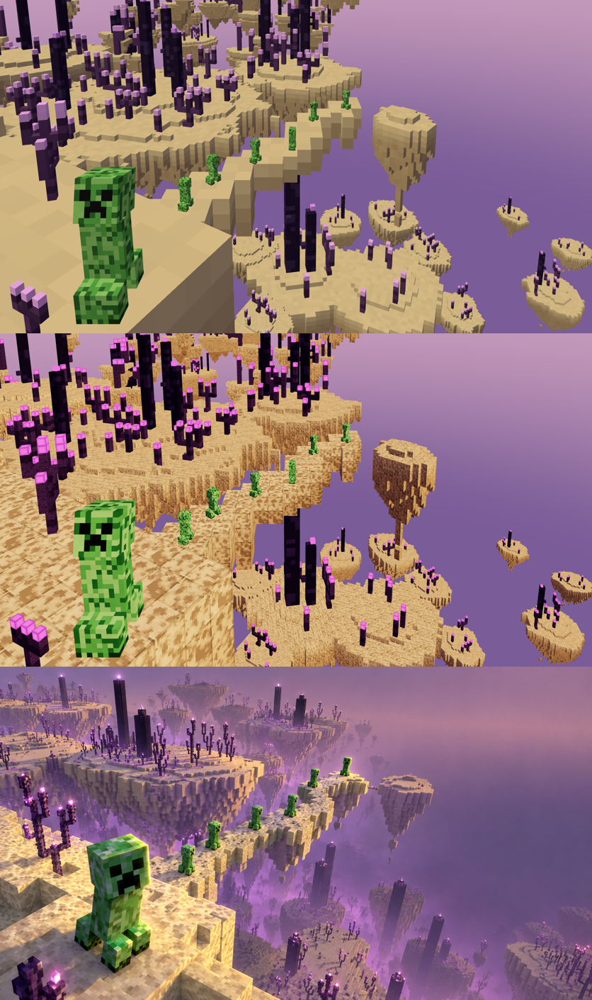
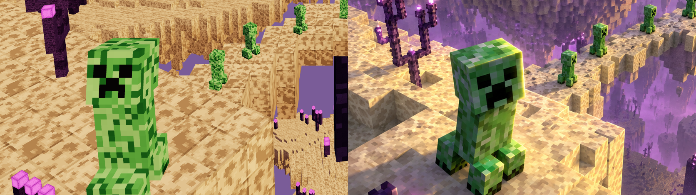
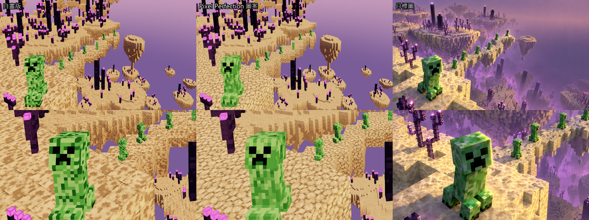

# 麥塊世界 mc3 — 04 貼圖、材質、環境光

上：階段 3 灰模　中：階段 4　下：目標圖

## 分工

| 誰 | 做什麼 | 檔案 |
|---|---|---|
| 主線 | 材質系統（依 `userData.slot` 換材質）、環境光 | `lib/materials.js`、`scene.js` 的 `ENV` |
| 子代理 | 16×16 方塊貼圖四張 | `lib/textures.js`，說明 [04-貼圖/textures.md](04-貼圖/textures.md) |

先由主線接好材質系統（佔位貼圖），再派子代理畫貼圖，同時主線調燈光，兩邊不碰同一個檔。

## 第二輪：末地石重畫＋變體（2026-10-29，用戶：「石頭材質不太對，需要數種變體」）

左：我們　右：目標圖。貼圖集：[04-貼圖/貼圖集.png](04-貼圖/貼圖集.png)（`textures.html` 可直接開來看）

第一版錯在三處，對目標圖放大看出來的：
1. **紋理尺度**：目標是一團團 2–3 像素大的暈斑（每面約 8×8 斑紋），第一版是 1 像素細碎深點，像泥土。→ 改成 8×8 粗格值噪聲門檻成斑、斑心深、斑緣過渡一階，每面外圈一像素略暗當方塊稜線。
2. **顏色**：斑要偏灰褐（乘上暖金底色後才是目標的褐斑），底色改暖金 `#f3d28e`。第一版斑偏橘、底偏白，像餅乾。
3. **光向**：目標朝右、朝鏡頭的面都是亮金色，主光其實在右前上方。`sunDir` 從 (-6,4.5,3) 改 (5,4.5,4)，曝光 1.5→1.25。

**變體**：`lib/voxel.js` 的 `VARIANTS = { endstone: 4, obsidian: 2 }`，貼圖畫成橫排 n 格的圖集，`merged()` 依「方塊座標＋面」hash 挑一格，整片不再重複。末地石第 4 種斑最多（較舊的石頭）。要加變體：改 VARIANTS 的數字，textures.js 會自動多畫幾格（每格不同 seed）。

（04-貼圖/tex-*.png 是第一版貼圖的截圖。）

## 試用：Pixel Perfection CE 圖案（2026-10-29，`?tex=pp`）

- 圖在 `themes/creeper-end/textures/pp/`（CC BY-SA 4.0，原作 XSSheep，見該資料夾 README；素材庫 `pixelperfection_end/`）。
- 方塊：PP 圖取亮度 → 正規化（平均 mean、對比 k）→ 乘色票；變體＝同一張轉 90°×i、奇數再翻。末地石 PP 原圖對比很低，k 要拉到 2.6 才看得到紋理。
- 苦力怕：`setCreeperSkin()` 後表面體素照原版 64×32 皮膚版型取樣（頭 (0,0)、身 (16,16)、腳 (0,16)），亮度映射到色票三階綠；臉仍用自己的臉。
- 比較：苦力怕 PP 版斑紋柔和、沒有碎點，較接近目標；末地石 PP 版是細碎卵石感，近景不如自畫的大暈斑像目標，但遠處較像石頭。
- 若採用，主題 README 要加 CC BY-SA 標示。

## 材質

- 貼圖**乘在頂點色上**：頂點色管每格明暗斑駁與固有色（palette），貼圖是接近白的明暗細節，所以換貼圖不會改色相。
- `endstone` / `obsidian` / `chorusStem`：Lambert＋貼圖＋頂點色。
- `chorusFlower` / `obsidianGlow`：Basic（不吃光），`color: #ff8af0` 乘上去拉飽和，免得被色調映射曝成白。bloom 在階段 5。
- 苦力怕：維持每像素頂點色（本來就是像素畫）。
- `?flat=1` 看回灰模固有色；`?layers=1` 分層上色不受影響。

## 環境光（`ENV`，`?env={…}` 臨時覆寫）

| 參數 | 值 | 作用 |
|---|---|---|
| sky / ground / amb | `#e2c6f2` / `#7a5a98` / 1.4 | 紫色天光當補光：側面、底面帶淡紫 |
| sun / sunI / sunDir | `#ffe2b0` / 3.0 / (5, 4.5, 4) | 暖金主光從右前上方打：頂面、朝右、朝鏡頭的面亮金色 |
| exposure | 1.25（ACES） | 第一輪 1.5 會把末地石曝成偏白 |

掃過 6 組（色溫偏橘會讓末地石變褐，選偏白的暖光＋提高曝光）。

## 和目標圖還差的（階段 5 處理）

1. **紫霧**：最大差距。遠處、下層島要被霧吃掉、變亮變紫，現在全都清清楚楚。遠景 IoU 也要等這個。
2. 島底的柔光（違反物理，prompt 有寫）。
3. 金色輪廓光（主角、橋、台地上緣）。
4. 花苞與柱頂光點的 bloom。
5. 黑曜石側面偏碎偏亮（見 textures.md）；苦力怕綠色偏粉嫩，目標更深更飽和。

## 效能

24.9 萬三角形、339 draw call（離屏截圖量的，未量 GPU 毫秒）。draw call 偏多：每株紫頌、每根柱子各自一個 mesh，階段 5 前要按島合併。
