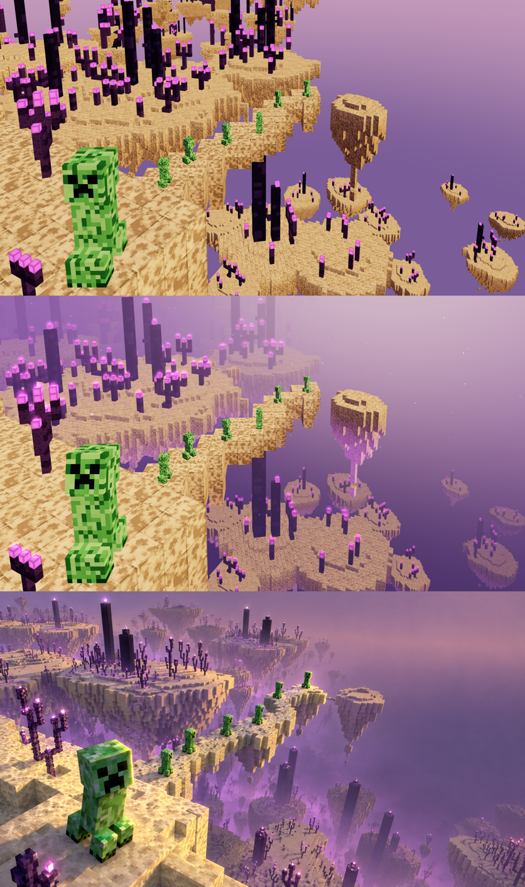

# 麥塊世界 mc3 — 05 燈光、特效、氛圍

上：階段 4　中：階段 5（待命）　下：目標圖

## 分工

| 誰 | 做什麼 | 檔案 |
|---|---|---|
| 主線 | 效能底子、紫霧、天空、島底柔光、背光、光暈、粒子 | `lib/atmosphere.js`、`lib/voxel.js` 的 `mergeBySlot`、`scene.js` |
| 子代理 | 六態狀態機＋苦力怕動作 | `states.js`，說明 [05-燈光特效/states.md](05-燈光特效/states.md) |

先由主線把角色（`window.theme.actors`）和每格回呼（`tickers`）開好、放一個 states.js 空殼，子代理只改 states.js，兩邊同時做不打架。

## 效能底子

- **合併 draw call**：每座島＋島上的柱子、紫頌，用 `mergeBySlot()` 依材質合成一個 mesh 一個材質 → 339 → 121 draw call。
- **渲染迴圈**：30 fps 上限、半解析度（`?full=1` 全解析，截圖對照用）、`window.wpPause(on)` 與分頁隱藏時停。
- 量測：`PERF=1 npx electron docs/麥塊世界mc3/tools/shot.js …` 連畫 60 格取平均。離屏在 RTX 2060 SUPER 上約 0.5 ms／格；**桌布實際跑在 Intel UHD 630，要裝上桌面再量**。

## 氛圍（`lib/atmosphere.js`，`?atm={…}` 臨時覆寫 `ATM`，`?noatm=1` 看回階段 4）

| 效果 | 作法 |
|---|---|
| 紫霧 | 注入每個材質（`patchMaterial`）：距離霧（起點 40、密度 0.0035）＋高度霧（y −30 到 −170 再加最多 0.5），在色調映射**之前**混，顏色＝天空同一個函式 |
| 天空 | 取代原本的漸層球：依視線仰角 上粉紫 `#9a6a86` → 地平紫 `#7a5694` → 下深紫 `#45325f`，加太陽方向暖暈；同樣經過曝光＋ACES，霧和天空接得上 |
| 島底柔光 | 末地石頂面（局部 y=0）以下越深越亮的粉紫自發光（`#b060d0`×0.45）。這個機位看不到朝下的面，所以按深度不按法線 |
| 背光 | 第二盞平行光從太陽方向（右上後方）打，給朝右、朝後的面一道金邊 |
| 光暈 | 掃所有紫頌花、柱頂光點朝上的面，每顆放一個加亮光點（世界大小、近大遠小、慢慢閃） |
| 粒子 | 鏡頭前 260 顆小光點緩慢上飄、淡入淡出 |

調色過程：第一版天空直接輸出線性色（沒做 sRGB 轉換）整片太暗；改走色調映射後又被曝光 1.25 拉得太白，掃三組後定在上表的值。

## 狀態與動作（子代理）

六態：不在／待命／思考（主角轉頭、綠光由近到遠接力）／執行（原地踏步）／收尾（由近到遠停步）／等你（主角柔和閃白）。對應規則照 sea-monster，見 [states.md](05-燈光特效/states.md)。截圖 `05-燈光特效/states-*.png`。

整合時修的：子代理為了閃白把每隻的材質 clone 一份，但 three.js 的 clone 不帶 `onBeforeCompile`，苦力怕會沒有霧 → 在 clone 後把注入接回去。閃白強度 0.3 → 0.08。

## 分層 IoU

分層檢查改用不吃光的純色材質（色調映射會把亮面的橘偏成黃、被誤判成中景）。現在 前景 0.91／中近景 0.68／中景 0.70／遠景 0.18。

## 留給階段 6（對比交付）

1. 下層島：目標圖又多又暗、被紫霧吃得更深、柱子更多；我們偏少偏亮。
2. 上緣遠島帶：目標圖左上到中間有一整排清楚的遠島剪影，我們被霧吃太多。
3. 整體對比：目標圖頂面更亮、暗部更紫，有明顯的金色光帶。
4. 主角回望角度、執行時主角頭朝正前方略側（子代理備註）。
5. 光點沿橋流（執行狀態）還沒做。
6. 在 Intel 內顯上量效能、`ref-mc3.png` 發布前移出主題資料夾。
