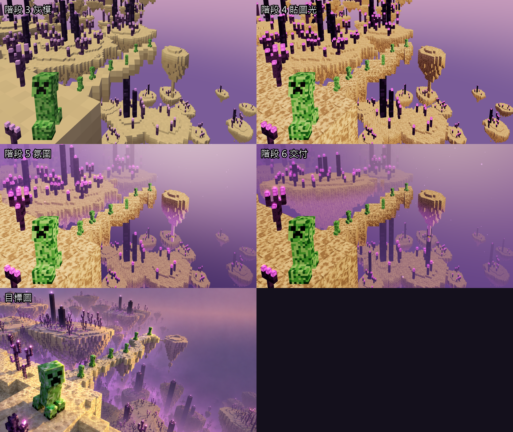
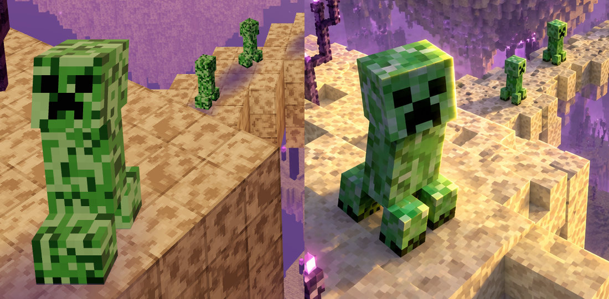
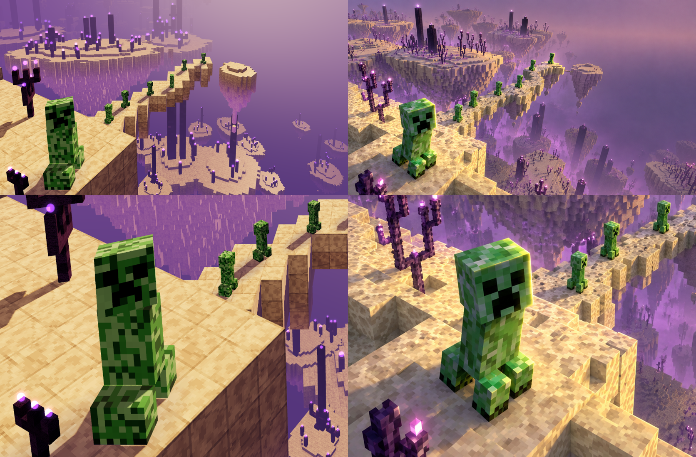
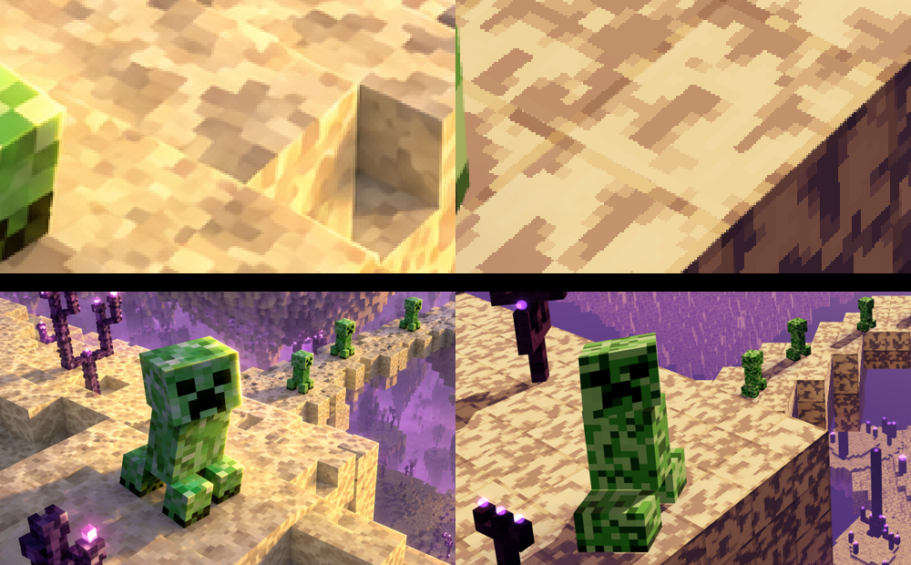
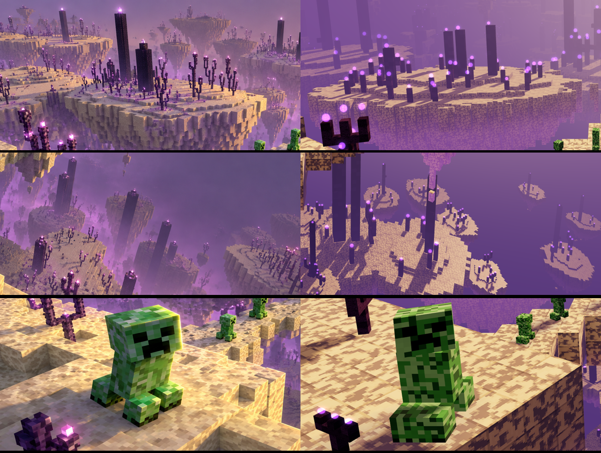
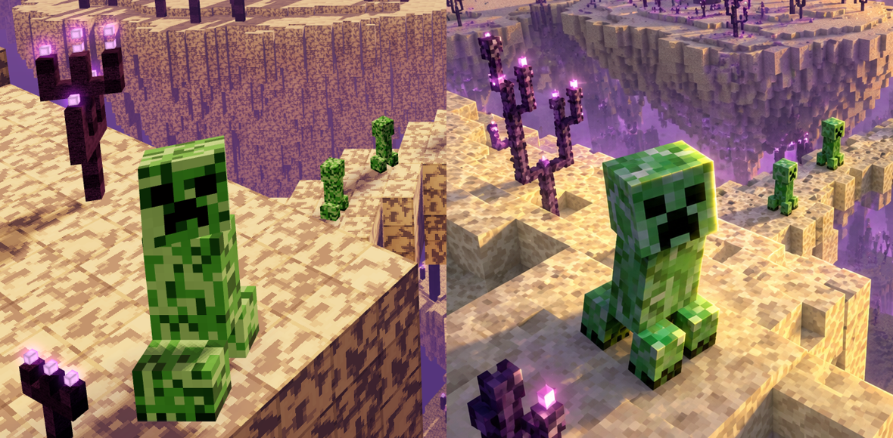
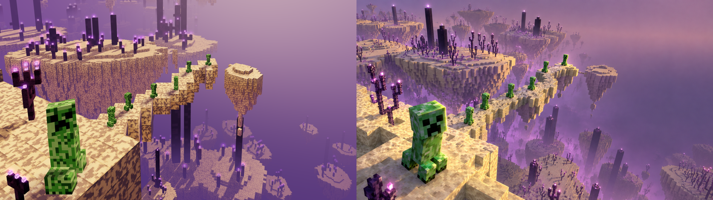
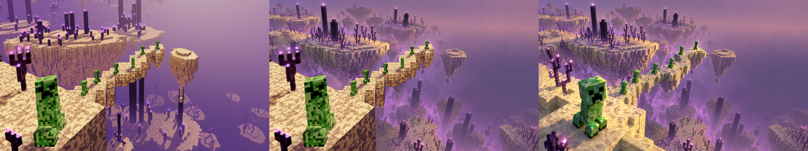

# 麥塊世界 mc3 — 06 對比交付微調

## 量化對比

新工具 `tools/colorcheck.py`：成品與目標圖各切 8×6 格，逐格比平均色（Lab ΔE）與亮度，印整體平均 ΔE、平均亮度、對比（L 標準差），可輸出色差格圖。
`tools/look.sh '<atm>' '<env>' [網址參數]`：一次拍成品（全解析、待命）＋算色差，用來掃參數。

| 指標 | 階段 5 | 階段 6 | 目標 |
|---|---|---|---|
| 平均 ΔE（越小越像） | 16.5 | **11.6** | 0 |
| 平均亮度 L | 57.6 | 51.2 | 48.3 |
| 對比（L 標準差） | 15.2 | 12.1 | 14.0 |
| 分層 IoU 前／中近／中／遠 | 0.91／0.68／0.70／0.18 | 0.91／0.68／**0.71**／0.18 | 1 |

色差格：[06-交付/色差格.png](06-交付/色差格.png)　分層：[06-交付/分層核對.png](06-交付/分層核對.png)

## 這輪改了什麼（照分數掃出來的）

| 改動 | ΔE | 說明 |
|---|---|---|
| 大島柱、紫頌縮小（`pillarH`、`plantH: 0.35`） | 16.2 → 15.5 | 植物太大太密，蓋掉大島台地 |
| 大島上移、倒錐加深（px [420,210]、`depth: 24`） | → 15.0 | 目標圖這一帶是大島參差的倒錐底部 |
| 下層島柱子變多變高（`lowerPillars [1,1,0]`、`lowerPillarH [20,12]`） | 持平 | 數字沒變，但補上目標圖下方的垂直節奏 |
| 曝光 1.25 → 0.85 | → 13.9 | 整體亮度對上（48.1 對 48.3） |
| 天色「上暗下亮」：天頂 `#8a5f7c`、下方 `#6a4e88` | → 12.3 | 逐格看出右上天空太亮、下方中間太暗（目標那裡是淡紫霧） |
| 大島縱深壓扁 `squash: 0.5` | → 11.6 | 大島遠緣不再一路延伸到畫面頂，上面露出遠景 |
| 執行狀態：橋上光流（`makeTrail`） | — | 一串綠白光點沿橋中線往前流，執行時淡入 |

試過但變差、沒採用：重新分配距離霧／高度霧（16.2 → 16.6）、主光加強（對比上升但 ΔE 變差）、上方中央島也壓扁。

## 光影補強（2026-10-29，用戶：「觀察一下光影，補光」「看起來是強背光、靠近地平線的角度」）

左：我們　右：目標

放大比對目標圖後的判斷：太陽在畫面右上後方、很低（逆光），所以朝鏡頭的面都不是直射光照亮，而是被柔和的暖色天光補亮；方塊之間的凹角有明顯暗角；苦力怕腳下有影子往左前方拉；苦力怕朝太陽的右側與頭頂有黃綠輪廓光。

| 改動 | 檔案 |
|---|---|
| **主光改成低角度背光**：方向＝天空太陽暈方向 `ATM.sunDir`（右上後方、仰角約 12°），強度 4.5；原本從右前上方打的主光拿掉 | `scene.js` 的 `ENV`、氛圍段 |
| **前方暖色補光** `fill #ffe2c8 ×2.2`：從鏡頭方向打亮逆光面，取代原本的紫色半球光主導 | `scene.js` |
| **方塊環境遮蔽（AO）**：原版麥塊那種頂點 AO，每個面頂點看側鄰格與角鄰格，凹角、交界、橋側自然變暗（四階 0.5／0.66／0.82／1） | `lib/voxel.js` `merged({ ao })`、`AO_LEVELS` |
| **苦力怕接觸陰影**：腳下一片往太陽反方向拉長的暗紫漸層貼片 | `scene.js` `makeBlob`，`ENV.blob` |
| **苦力怕輪廓光**：只正對太陽的面加暖色（pow 2） | `lib/atmosphere.js` `patchMaterial({ rim })`，`ATM.rimI` |
| 苦力怕色票改深、降飽和；末地石斑再淡一階 | `lib/palette.js`、`lib/textures.js` |

也做了真正的投影（`ENV.shadow: 1`，PCF 軟影、只投近景＋中近景），但逆光角度下影子都落在角色背後、看不出差別，又吃內顯效能，預設關。

分數：ΔE 11.6 → 11.5、IoU 不變（光影是局部細節，平均色差不敏感，這輪以目視為準）。

## 用戶回饋第二輪（2026-10-29）

- **隨機走動**（「讓他們在各自的平台隨機走動」）：`states.js` 的 `PARAMS.wander`。不在／待命／思考時，每隻在自己的平台挑附近一格走過去（先轉身再走、踏步），停 2.5–7 秒再挑；執行時原地踏步、收尾停下、等你定格。可走的格由 `scene.js` 的 `walkCells()` 給：只收和腳下同高、四鄰都在的格（窄橋放寬到三鄰），主角限在離家 1.6 個身高內且腳底落在畫面左下（`heroBox`），隊伍成員離家不超過到最近同伴距離的 0.48 倍（不會撞在一起）。主角邊走頭邊轉向鏡頭（扣掉身體朝向，最多 ±80°）。
- **末地石往拋光大理石**（用戶糾正：是要更像，不是更不像）：拿掉顆粒與小孔，斑點再淡、加一兩條細紋路；材質改 Phong（`shininess 60`），逆光在頂面反出柔亮。
- **紫頌花／柱頂＝弱紫光球**：方塊藏起來，改成光球（`makeHalos` 加圓球本體＋外圈柔光，`#c98cff`，位置在原方塊中心）。
- 錄影：主題補了 `applyState`／`setSessions`／`CONFIG.polling` 測試介面；動態分鏡 `E:	mp\creeper-end-storyboard\`。

## 用戶回饋第三輪：陰影銳利、光更強、地板反射（2026-10-29）

- **即時投影預設開**（`ENV.shadow: 1`，4096 解析度、`shadowSoft: 0`＝銳利 PCF；只投近景＋中近景）。原本以為逆光看不出影子，其實是太陽仰角只有約 12°，影子長達身高 5 倍、全落到畫面外；主光另給 `keyDir`（同方位、仰角約 35°），影子變成目標圖那種約一個身長、往左下。
- **光的對比**：主光 4.5→8，天光 1.4→0.7，前方補光 2.2→0.9，曝光 0.88。影子只扣掉主光，補光太強影子就淡。接觸陰影貼片降到 0.3（有真影子了）。
- **地板反射**：末地石 Phong 高光＋拋光反射（反射天空色，掠射角越強，`ATM.refl 0.5`）。高光第一版太強（`#c8b090`）會把下層島頂面曝白——逆光的反射方向正好進鏡頭——降到 `#5a4c3c`、`shininess 80`。
- 低處霧加濃（`hMax 0.7`、`hTop -40`、`skyLow #5e437e`）。
- 分數：ΔE 11.9。已知：下層島整體仍比目標亮約 30、偏黃（被照亮的頂面主導，霧推不下去）。
- 效能：RTX 2060 SUPER 離屏 0.71 ms／格（開投影前 0.5），內顯仍未量。

## 末地石高對比貼圖（2026-10-29，用戶：「味道對啦，只差地質需要點高對比貼圖」）

量目標圖平台頂面乾淨的一塊：暖奶油底上**冷灰褐塊狀斑**，斑 2–4 格、蓋約 1/3 面積，斑對底亮度比約 0.66–0.8；我們上一版斑太淡太平滑（像大理石）。重畫 `lib/textures.js` 的 `endstone`：值噪聲門檻成塊斑、邊緣抖動成碎格，斑色偏冷（藍多）——貼圖乘在暖黃頂點色上，偏冷才乘得出灰褐而不是橘。保留 Phong 高光與拋光反射。

## 中後景光影（2026-10-29，用戶：「中後景的光影一併處理」）

左：目標　右：我們（上：大島，中：下層島群，下：近景確認影子仍銳利）

目標圖的中後景：柱子、紫頌在島頂拉出長影，台地面明暗分明。我們原本只有近景＋中近景投影，中景全是平光。
- 試過「兩盞同方向、各半強度的光，各罩一張陰影圖」（`ENV.shadowMid`）：中景影子只有一半濃，太淡，保留成選項。
- 採用 `ENV.shadowAll: 1`：同一張 4096 陰影圖連中景一起罩（範圍半徑約 413），近景影子仍夠銳利，中景柱子、紫頌影子清楚。
- 效能：離屏 RTX 2060 SUPER 0.71 → **2.29 ms／格**（陰影圖要把整個中景再畫一次深度）。內顯可能變成幾十毫秒，裝桌面時要量；太重可改成中景只讓柱子、紫頌投影，或降到 2048。

## 島底方塊與紫頌晶塊（2026-10-29，用戶圈兩處＋「底部方塊光影分明，應該不是霧的關係」）

- **島底**：目標是一根根長短不一的方塊柱，每根有亮的正面、暗的側面、柱間暗縫。我們原本倒錐太平滑（看起來是一面牆），又被距離霧＋島底紫光蓋成一片紫。
  - `makeIsland({ jag })`：底部以 2×2 為一組各自隨機加長（大島 0.9、下層島 0.7），柱與柱長短差大。
  - 前方暖補光 `fill #ffd8a8 ×2.0`：照亮柱子朝鏡頭的面（主光在背後）。
  - 距離霧 0.0035 → 0.0015（低處高度霧保留）；島底紫光 0.45 → 0.08。
- **紫頌花／柱頂**：目標是小而亮的粉白晶塊＋光暈，不是暗紫圓球。花苞方塊各自往中心縮成 0.55 大（`shrinkCubes`），`#ffc8ff` 不吃色調映射，外圈光暈 `#e070ff`。
- 分數：ΔE 12.3（距離霧變淡，遠處比目標清楚），IoU 不變。下層島群又變得比目標亮、清楚——目標那裡是低處濃霧，下一輪可單獨加濃低處霧。

## 低處霧（2026-10-29，用戶：「把下方島群的低處霧加濃，讓它退到背景」）

島頂高度：大島 −40、下方島群 −100 到 −170。高度霧改成從大島底下開始、陡升（`hTop −80`、`hBot −120`、`hMax 0.9`），只吃下方島群，大島底的方塊柱不受影響。
量畫面右下那塊的平均色：霧前 [173,134,141]，現在 [134,93,129]，目標 [137,96,135]。大島底那塊不變。ΔE 12.5、IoU 不變。

## 裝桌面＋內顯效能（2026-10-29）

- 安裝：`E:	mp\creeper-end-install\sync.ps1`（WMI 在 MSIX 套件外執行；鏡像本 worktree 的主題到 `%APPDATA%ibing-wrapper	hemes\creeper-end`，排除 `ref-mc3.png`、設 enabled、切成桌布、重啟 VibingWrapper）。debug.log：`[wallpaper] open …/creeper-end/index.html?night=1`、attached 1920×1080。改完重跑同一支即可。
- 量測：`LOWPOWER=1 PERF=1 npx electron docs/麥塊世界mc3/tools/shot.js "creeper-end/index.html…" out.png 1920 1080`（LOWPOWER 強制內顯，確認 renderer＝Intel UHD 630；每格讀回一個像素逼 GPU 畫完——ANGLE 的 gl.finish 不會等，第一次量到 2.7 ms 是假的）。

| 設定（1920×1080、半解析度） | Intel UHD 630 |
|---|---|
| 全開（投影連中景） | **14.7 ms／格** |
| 投影只罩近景＋中近景 | 15.6 ms（誤差內） |
| 關投影 | 13.9 ms |

規格建議 12 ms 內，超一點；投影只佔約 1 ms，大頭在場景本身（25 萬三角形、霧注入的逐像素運算、光暈粒子）。30 fps 上限下每格預算 33 ms，跑得動。

## 前景 3D＋中遠景貼圖（2026-10-29 用戶點子，**已設為預設**；`?bg=0` 回全 3D）

左：全 3D　中：`?bg=1`　右：目標

- 只留近景＋中近景（平台、主角、近景紫頌、橋＋六隻）是 3D；中景、遠景、天空球藏起來，`scene.background` 換成 `textures/backdrop.jpg`。
- 背景貼圖：`tools/backdrop.py` 把 Codex 的遠景＋中景扣圖疊起來，前景挖掉的洞（約 24%）用 OpenCV inpaint 補；Codex 把目標圖斷崖亮邊留在中景層，洞附近 60px 的「末地石黃」也當洞一起補掉。洞大多被 3D 前景蓋住。
- 效果：ΔE 11.8 → **4.5**（背景就是目標圖）；內顯 UHD 630 **14.5 → 8.3 ms／格**（中遠景幾十萬面不用畫，陰影圖也小）。
- **為什麼改預設**（用戶）：中遠景全 3D 很耗資源，但畫面上效果超級不明顯——那一帶本來就在霧裡、又小又遠，動態也看不出來。
- 取捨：背景是靜止的——中遠景的光球不會閃、霧不會動、不跟日夜／狀態變；鏡頭不能動（本來就固定）。前景動態、苦力怕走動、橋上光流都保留。

## 交付狀態

- 成品：[06-交付/成品-待命.png](06-交付/成品-待命.png)、[成品-執行.png](06-交付/成品-執行.png)（含橋上光流）、[成品對目標.png](06-交付/成品對目標.png)
- 還差的：
  1. 遠景 IoU 0.18：Codex 遠景層多是霧中淡島，我們的遠島群偏少，右下也沒有。
  2. 對比偏低（12.1 對 14.0）：目標圖近景頂面更亮、霧中暗柱更暗；整體加對比會讓 ΔE 變差，需要局部（近景補光／暗柱）而不是全域調。
  3. 苦力怕綠偏粉嫩（?tex=pp 版較接近，未定案）。
  4. **效能未在 Intel 內顯量**；`ref-mc3.png` 發布前要移出主題資料夾；`theme.json` 仍 `enabled: false`。
