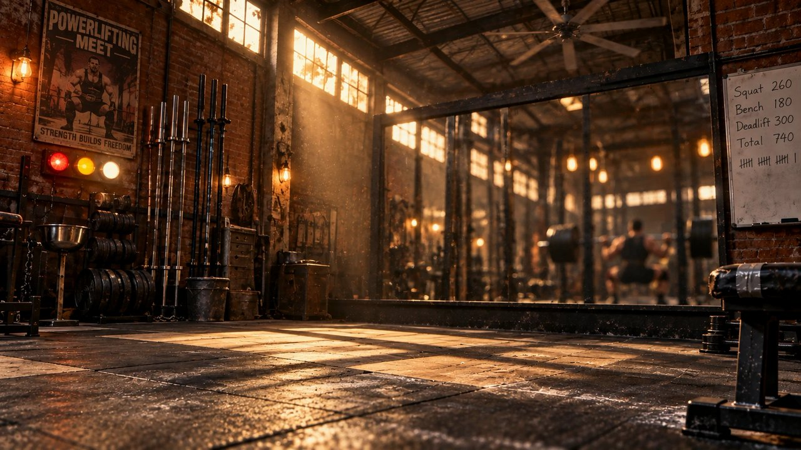
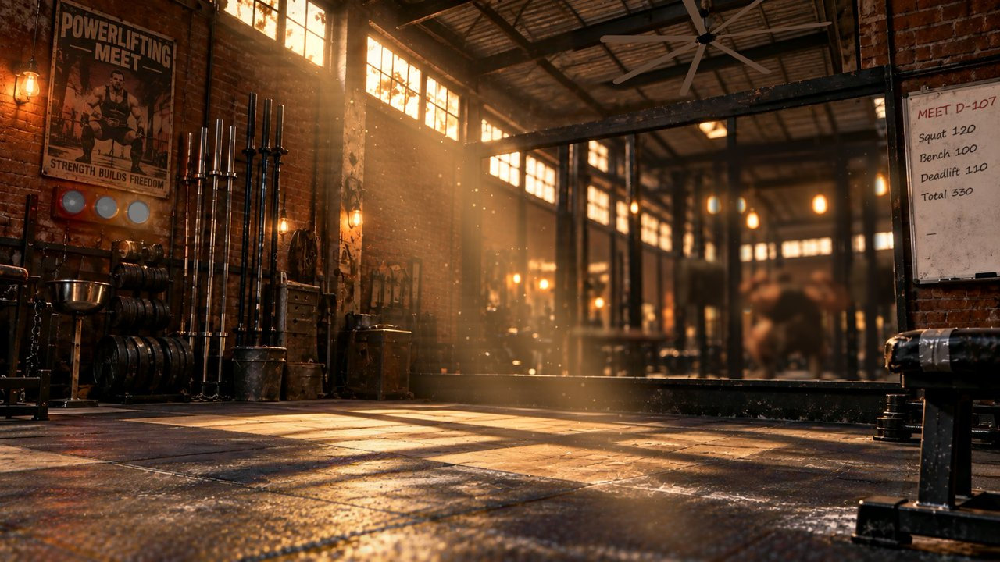
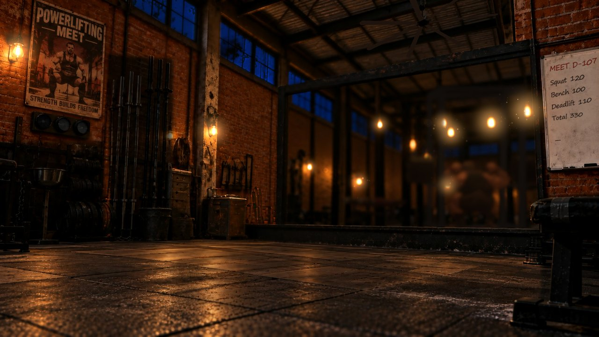

# 健力健身房 2（powerlifting-gym-2）

夕陽從高窗斜切進倉庫健身房，粉塵在光裡慢慢翻；鏡子深處有個模糊的人影在深蹲。Claude 在做事，他就在練。
第一版（`powerlifting-gym`）的選手動作與近景不夠細緻，這版把氛圍交給**光影**和**鏡面模糊**：近景細節靠高解析平面圖，選手退到鏡中糊掉。
製作過程（00 分析 → 06 交付）在 `docs/健力健身房2/`。

| 目標圖（Codex 生成） | 完成・白天 |
|---|---|
|  |  |

| 完成・夜晚 |
|---|
|  |

光束、粉塵、地板光斑、鏡中選手都是即時畫的；截圖是執行中的同一個姿勢（深蹲最低點）。

## 狀態

| state.json | 鏡中選手 | 光與灰 |
|---|---|---|
| sessions 全空 | 走出鏡子，空架 | 室內燈關一半；光束 0.8、粉塵少 |
| `clear` 待命 | 走到凳子坐下休息，偶爾站起來抹粉 | 正常 |
| `overcast` 思考 | 走到槓前、半蹲踏步進槓下，蓄力深呼吸 | 雲每幾秒飄過一朵，光忽明忽暗 |
| `storm` 執行 | 起槓，一下接一下深蹲；每 3 下卡一次黏滯點 | 光束最亮、粉塵最多；每 60 秒加一對片（4 → 6） |
| `waiting` 等你 | 扛著槓站好，等主審喊「Rack」 | 中間那顆裁判燈慢慢呼吸 |
| `clearing` 收尾 | 掛回槓，走回凳子 | 三顆裁判燈一起變白；粉塵 6 秒內慢慢浮起再落回；白板多一筆劃記 |

日夜：白天＝高窗斜射的光束（左上往右下）、地上窗格光斑隨時間挪動；晚上＝窗外深藍、光束關掉，燈泡帶光暈。`?day=1`／`?night=1` 固定。

## 參數（`window.theme.PARAMS`）

| 參數 | 預設 | 說明 |
|---|---|---|
| `meetDate` | `'2027-02-15'` | 比賽日，白板第一行 `MEET D-xx`（2027 年二月中，確切日期未定） |
| `lines` | `['Squat 120', 'Bench 100', 'Deadlift 110', 'Total 330']` | 白板四行（白板只露出窄窄一條，每行約 12 字內） |
| `basePlates`／`maxPlates`／`plateEvery` | 4／6／60 | 每邊起始片數、上限、執行中每幾秒加一對 |

今日劃記存在瀏覽器（`localStorage`，隔天換 key 自動歸零）。鏡中倒影的光與模糊集中在 `LAYOUT.mirror`。

## 檔案

| 檔案 | 內容 |
|---|---|
| `index.html` | 鏡中房間、狀態機（沿用第一版 8 段動作）、燈光與各狀態的光、灰、雲 |
| `assets/plate.js` | 底圖合成：日／陰／夜三張混合、地板光斑挪動、鏡中倒影、裁判燈、燈泡光暈、白板字、光束 |
| `assets/light.js` | 光束（小畫面逐格回推窗光）、粉塵（只在光裡亮） |
| `assets/mirror.js` | 鏡中小畫面＋兩趟高斯模糊（`?blur=1|2|3`，預設 2） |
| `assets/armfix.js` | 扛槓姿勢執行期修正：肩略抬、握距內收、手肘朝下（每格畫完還原，動作檔沒有手臂關鍵格） |
| `assets/board.js` | 直式白板字 |
| `assets/fx.js`、`iron.js`、`props.js`、`lib/`、`models/` | 第一版沿用：吊扇、槓、架、凳、材質、選手 GLB |
| `models/mb-root.json` | 坐下（`SitDown`）、站起（`StandUp`）的地面位移與轉向，每秒 30 格 `[x, z, 轉向]`；動作本身在 GLB 裡原地播，由程式帶著走 |

## 動作

選手的走路、坐下、坐著、站起是用 NVIDIA [MotionBricks](https://github.com/NVlabs/motionbricks) 生成的（2026-10-31）：只給起點與目標姿勢，中間的起步、轉身、放慢坐下由模型補出來，再轉到選手的 Mixamo 骨架烘進 `powerlifter.glb`。扛槓、深蹲、抹粉仍是第一版的動作。
MotionBricks 程式碼 Apache-2.0，模型為 NVIDIA Open Model Agreement。生成與轉骨架的做法見 `docs/健力健身房2/07-動作生成.md`。
| `textures/` | `plate-day／shade／night.jpg`（Codex 修好的底圖）、`mask-a.png`（R 窗 G 鏡面 B 地上光斑）、`mask-b.png`（R 燈泡 G 整個地板） |

除錯網址參數：`?clip=Squat&t=1.8` 選手停在單一姿勢；`?blur=0` 不模糊；`?mres=4` 鏡中小畫面放大 4 倍；`?noarm=1` 關掉姿勢修正；`?tune={json}` 覆寫 `LAYOUT`。

## 效能

30 fps 上限、半解析度（`?scale=` 可改）。內顯 1080p 約 11.4 ms／格（2026-10-31，`PERF=1 LOWPOWER=1`）。
